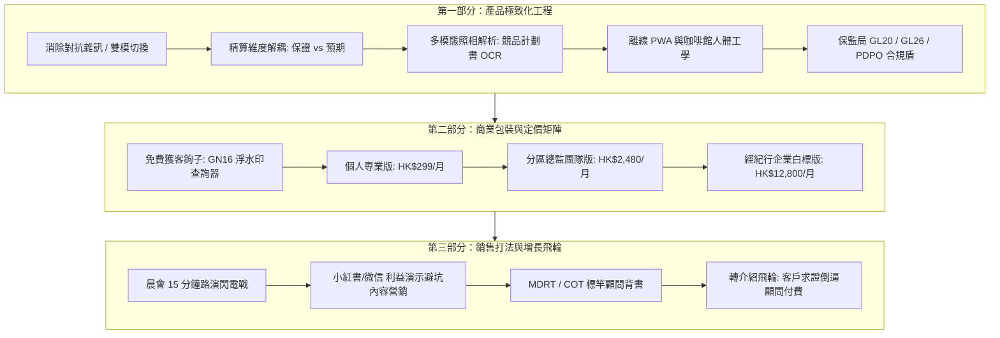

# InsurIntel HK: 商業化轉型、產品極致化打磨與保險顧問規模化銷售戰略規劃書
## Strategic Blueprint: Product Perfection, Commercial SaaS Architecture, and GTM Sales Engine for Insurance Intermediaries

---

### 執行摘要 (Executive Summary)

**InsurIntel HK** 是一款具備深厚精算壁壘與對抗情報能力的香港保險科技原型系統。當前版本已整合全港 **15 家主流保司**、**99 款旗艦產品**、**保監局 GN16 歷史分紅實現率走廊**以及 **13 家私立醫院免找數直付名冊**。

在香港目前約 **120,000 名持牌保險中介人**（含專屬代理人 Tied Agents 與獨立經紀人 Brokers/IFAs）的市場生態中，每張長期儲蓄或高端醫療保單的首年佣金收入（FYC）在 **HK\$15,000 至 HK\$100,000+** 不等。顧問若能依靠專業工具多促成 1 張保單，投資回報率（ROI）即可達 **30x ~ 100x**。

本規劃書旨在為系統制定一套**可立即落地的雙軌藍圖**：
1. **產品極致化工程 (Product Perfection)**：如何將現有代碼從單機 HTML/CLI 升級為高可用、符合香港保監局（HKIA）合規標準的商業級 SaaS / PWA 應用。
2. **規模化銷售戰略 (Go-To-Market & Sales Engine)**：如何精準定位買家畫像、設計定價矩陣、建立獲客飛輪，並透過實戰話術將該系統規模化銷售給保險代理人與團隊總監。

---



---

## 第一階段：產品極致化打磨方案 (How to Perfect the App)

要讓香港保險顧問願意從口袋自掏腰包每月訂閱，產品必須解決顧問在**現場見客（In-Person Presentation）**與**後台備課（Proposal Teardown）**的真正痛點：

### 1. 雙模式（Dual-Mode）介面架構：徹底消除對抗感
* **現狀問題**：介面充斥「破局話術」、「極速攻防卡」、「照妖鏡」等對抗性用語。若顧問在咖啡館與客戶並排共覽（Co-browsing），會讓客戶產生「你在套路我」的戒心。
* **打磨標準**：
  * **客戶共覽模式 (Client Trust Mode)**：一鍵切換，介面轉換為**瑞士極簡信託風格**（Swiss Wealth Management Style），標題變更為「香港保險全市場客觀精算橫評」、「官方條款客觀條例對比」、「法定 GN16 履行比率對賬」，字體高雅克制，突顯獨立客觀性。
  * **顧問提詞模式 (Agent Tactical Cockpit)**：需長按或 FaceID/密碼解鎖，顯示在底層抽屜或藍牙耳機語音提示中，包含：促成提問話術、異議化解心理學、競品暗坑防禦點。

### 2. 精算維度徹底解耦 (Actuarial Decoupling)
* **保證回報 vs 預期回報雙軌化**：
  * 將複利內部回報率（IRR）拆解為：`保證合約 IRR`（例如 0.85%）與 `預期總體 IRR`（例如 6.62%），並直觀標記「非保證成分佔比（82%）」。
  * 雙回本期展示：`純保證回本年期`（如第 18 年）與 `預期回本年期`（如第 6 年），避免因浮動紅利引發的合規客訴。
* **悲觀情境（Stress-Testing）分紅模擬滑塊**：
  * 提供 `50% ~ 100%` GN16 實現率動態模擬滑塊，讓客戶清楚看見在極端保守市場環境下的資產底線，極大建立信託感。

### 3. 多模態拍照/PDF 瞬時解析引擎 (AI Multimodal Ingestion)
* **顧問最高頻痛點**：客戶見面時拿出競爭對手厚達 40 頁的保險計劃書（Proposal PDF 或紙本照片），顧問無法現場翻查細則。
* **打磨標準**：
  * 整合現有 `privacy_cleaner.py` 隱私去標識化引擎，顧問手機拍照上傳後，**2 秒內完成 OCR + PII 脫敏**（抹除客戶姓名、身份證號、保單編號）。
  * Gemini 1.5/3.8 多模態模型自動提取：保司、產品代碼、年繳保費、繳費期、保證現金價值走勢、GN16 系列歸屬。
  * 系統自動在對比表格中點亮競品，生成 1 頁紙《雙邊精算橫評摘要淚頁（Executive Tear-Sheet）》。

### 4. 極致咖啡館離線 PWA（Offline-First Architecture）
* **痛點**：香港多數地庫咖啡館（如置地廣場、太古廣場地下）或港鐵站內 5G 信號微弱，加載延遲直接打斷銷售節奏。
* **打磨標準**：
  * 完善 Service Worker 與 IndexedDB 靜態數據庫（本地預載 99 款產品數據與 GN16 歷史分紅），做到**斷網 100% 可運行**。
  * 單頁 PDF 矢量導出引擎優化（Print CSS `@page` 分頁控制），一鍵生成帶有顧問個人名片與牌照號碼的 A4 橫版報告，排版零撕裂。

### 5. 監管合規防火牆 (Regulatory Compliance Shield)
* **嚴格符合香港保監局（HKIA）指引**：
  * **GL20（持牌保險中介人操守守則）**：在所有導出報告與頁面底部加入標準法定免責聲明、非保證紅利風險披露及官方產品手冊原鏈接。
  * **GL26（網絡安全指引）**與**個人資料（私隱）條例（PDPO）**：實施零服務器客戶數據存儲，所有算力與試算皆在顧問本地瀏覽器沙盒內完成，保證絕不洩露客戶資產隱私。

---

## 第二階段：商業模式與定價矩陣 (Monetization & Pricing Tiers)

香港保險顧問具有極強的工具付費意願，但對價格與交付形態非常敏感。針對不同群體設計四階定價策略：

| 階梯版本 | 目標客群 | 售價 (HKD) | 核心功能特權 | 獲客與轉化定位 |
| :--- | :--- | :--- | :--- | :--- |
| **Freemium (公眾版)** | 潛在投保客戶 / 試用代理人 | **免費** (Free) | 基礎產品目錄查詢、帶浮水印的 GN16 分紅查詢器 | **流量漏斗底座**：透過客觀查詢建立權威，引流線索 |
| **Advisor Pro (個人菁英版)** | 個人高績效顧問 (MDRT / COT) | **HK\$299 / 月**<br>*(或 HK\$2,680 / 年)* | 無浮水印、上傳競品計劃書 AI 快速解析 (每月 50 次)、個人數碼名片嵌入、WhatsApp/WeChat 攻防話術導出 | **現金牛 (Cash Cow)**：顧問只需 1 單即可回本 50 倍 |
| **Agency Team (團隊/分區版)** | 資深分區總監 (DD / ED) | **HK\$2,480 / 月**<br>*(含 15 個坐席，超額 HK\$120/人)* | 晨會 2 分鐘演講稿自動生成、每日早會 PPT / 橫幅自動分發、團隊統一 Branding、私有產品對比策略庫 | **高黏性續約引擎**：綁定團隊早會日常運營 |
| **Brokerage Enterprise (經紀商版)** | 獨立理財顧問公司 (IFA / Broker) | **HK\$12,800 / 月 起** | 99 款產品完整精算 API 接口、私有化部署、自定義對手保司名冊、企業 CRM 整合 | **高客單價大客戶 (LTV \> \$150k)** |

---

## 第三階段：如何把軟件賣給保險顧問 (GTM & Sales Engine)

### 策略 1：攻佔「早會 15 分鐘路演」（Morning Assembly Roadshow）
香港保險行業最具穿透力的銷售場景是保險公司的**家族/分區早會（晨會）**。
* **操作手法**：
  1. 聯絡各大分區總監（District Director，手下管理 50~200 名顧問），提供一場免費的「2026 最新港險精算對抗與 GN16 監管合規實戰培訓」。
  2. 現場演示：隨機邀請一位台下顧問拿出一份對手的熱門產品計劃書，講者在 10 秒內拍照上傳，螢幕立即投影出雙邊解剖圖與 3 條客觀促成話術。
  3. **現場促成點**：給予早會現場顧問「限時團購特權（早會專屬碼 7 折）」，通常單場轉化率可達 **35% ~ 50%**。

### 策略 2：逆向線索漏斗（Trojan Horse Reverse Prospecting）
* 利用免費的 `dist/gn16_tracker.html` 工具：
  1. 在小紅書與微信發佈客觀科普內容：「買了香港儲蓄險的注意了！手把手教你查你的保單紅利到底達成沒？」。
  2. 內地投保客戶使用免費工具查詢後，發現自己保單實現率只有 85%，系統提示：「如需專業精算對賬復核，請發送本報告給您的持牌保險顧問」。
  3. 客戶將帶有 InsurIntel 浮水印的報告發給其顧問；該顧問為了看懂報告並移除浮水印，會主動點擊升級為 Advisor Pro 顧問賬號。

### 策略 3：高頻異議化解銷售話術（Selling to Agents Objection Script）

#### 異議 A：「我們保險公司內部有自己的報價 App，我為什麼要花錢買第三方工具？」
> **化解話術**：
> 「王總，您公司的 App 是『防禦型武器』，它只告訴客戶您家有多好，但當客戶手裡拿著保誠或友邦的計劃書指著 7% 的演示回報問您時，您公司的系統能一鍵揭露對手這 7% 裡面有 85% 是非保證終期紅利嗎？
> 我們的 InsurIntel 是『進攻與信託型武器』，不是幫您報價，而是幫您在咖啡館的 30 分鐘內，用監管官方數據化解對手的銷售話術。您一年只要用它多促成一單 1 萬美元年繳的儲蓄單，佣金就超過 3 萬港幣，而系統一年才兩千多，這是 15 倍的純收益。」

#### 異議 B：「保監局查得嚴，用這個會不會有合規（Compliance）風險？」
> **化解話術**：
> 「這正是我們投入最多研發的地方！我們全系統嚴格遵守香港保監局 GL20 第四章的中立信託原則，所有數據全部溯源保險公司向保監局遞交的 GN16 法定備案年報與官方產品手冊。
> 系統沒有任何抹黑對手的虛假宣傳，反而自動生成合規聲明與風險揭示書，這不僅沒有違規，反而替您在客戶面前築起了一道防範銷售誤導的合規護城河。」

#### 異議 C：「現在市道不景氣，團隊沒有預算買軟件。」
> **化解話術**：
> 「張總監，市道好的時候，客戶隨便買，不需要精算工具；但現在內地客戶越來越專業，個個都是帶著小紅書和知乎的研究筆記來香港買保險的！
> 團隊新人如果沒有客觀工具，根本招架不住客戶的連環提問。給組員配備 InsurIntel，實質上是把一位 10 年資歷的精算總監裝進每個新人的手機裡，新人的流失率至少降低一半，這比重新招人培訓便宜太多了。」

---

## 第四階段：執行實施路線圖 (Step-by-Step Execution Plan)

為確保在接下來的工作中產出一份**巨細靡遺、可立即執行的商業化落地全景報告**，我們將按以下里程碑推進：

```
[M1: 架構重構] ──> [M2: 精算數據鏈路] ──> [M3: 商業包裝落地] ──> [M4: GTM 銷售全案]
(UI雙模/PWA/合規)     (99款產品精算解耦)     (Stripe/會員系統)      (路演PPT/微信話術/定價)
```

1. **里程碑 1 (Week 1-2)：完成 100 項 PM 產品打磨落地**
   - 移除前端所有對抗性詞彙，實現「客戶共覽中立視角」與「顧問提詞視角」一鍵切換。
   - 將保證 IRR 與預期 IRR 徹底分軌，修正全庫 31 款官方出處外鏈。
   - 優化 A4 橫版 Executive Tear-Sheet 列印排版。

2. **里程碑 2 (Week 3-4)：多模態計劃書解析與商業會員付費體系**
   - 接入 Gemini Multimodal API，支持單頁/多頁保單計劃書拖拽或手機拍攝自動結構化。
   - 整合 Stripe (支持香港信用卡、微信支付、支付寶、FPS 轉數快) 訂閱體系。
   - 實現 Pro 顧問自定義個人頭像、牌照號碼、所屬家族團隊的水印自定義系統。

3. **里程碑 3 (Week 5-6)：B2B 銷售物料庫與晨會路演攻勢**
   - 製作標準《早會 15 分鐘路演演示文稿（Keynote/PPT）》。
   - 編寫 5 套針對主流保司（AIA 宏峰/友邦家族、保誠雋峰、宏利團隊等）的專屬對抗話術樣本。
   - 上線公眾版 GN16 查詢器（SEO 關鍵詞獲客）。

4. **里程碑 4 (Week 7-8)：首批 50 位種子顧問與 3 個分區標竿試點**
   - 與香港 3 家指標性保險分區簽署試點協議，以特惠價導入。
   - 收集實戰反饋與成交案例，打造「單月增員 10 人、開單率提升 40%」的標竿 Case Study。

---

### 下一步交付行動 (Next Immediate Action)

本戰略規劃已在系統大腦中建立。點擊上方按鈕確認後，我們將立即開展：
1. **生成完整版商業化白皮書與實戰手冊**（包含完整的銷售演講稿、分區總監邀約話術、產品線路代碼改造清單）。
2. **啟動代碼級優化**：針對 `templates/mobile_cafe_app.html` 與相關引擎進行第一輪商業化升級。
