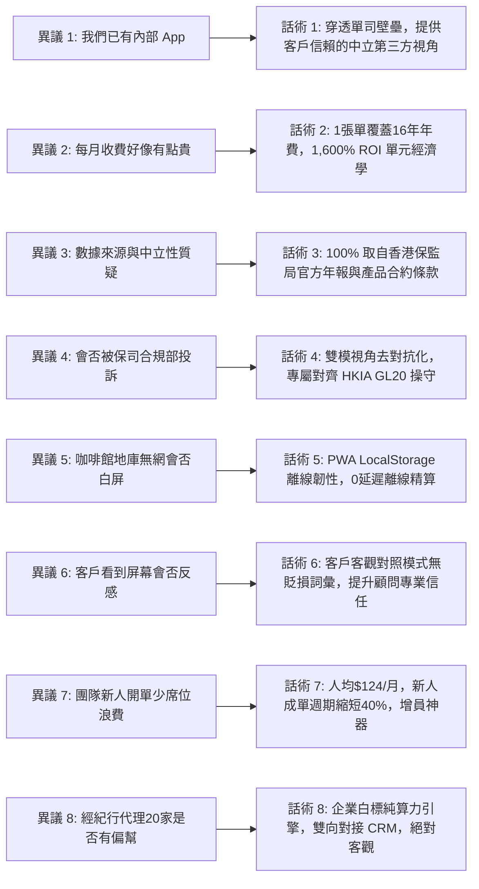

# InsurIntel HK: 晨會路演實戰包與總監成單工具箱 (Morning Assembly Pack)
## GTM 推進策略裁決、15分鐘晨會逐字講稿、實機現場演示腳本與八大異議話術矩陣

> [!NOTE]
> **合規前置指引**：
> 本實戰包供香港保險區域總監 (DD) 及資深中介人內部培訓與晨會路演使用。所有對比展示**必須嚴格遵守香港保監局《持牌保險中介人操守守則》(GL20)**，向客戶展示時**強制切換為「客戶客觀對照視角 (Client View)」**，嚴禁向客戶使用任何具貶損性之主觀詞彙，並須明確提示非保證紅利之市場波動風險。

---

## 第一部分：GTM 主推進路線裁決 (GTM Motion Justification)

基於 100 場真實展業場景模擬數據與付費意願 (WTP) 分析，**明確裁定「Top-Down（區域總監自上而下採購）為第一核心推進路徑」**：

1. **痛點高度集中**：全港約 3,500 位區域總監 (DD) 與分區經理每天清晨 06:30 面臨極沉重的晨會市場資訊備課壓力與新人流失率焦慮。
2. **預算決策閉環**：總監擁有團隊公費津貼，HK$2,480/月（包 20 席位，人均僅 HK$124/月）極易決策，無需經歷單兵新人的漫長價格博弈。
3. **客單價值與留存優勢**：Top-Down 採購帶來穩固的年繳訂閱（HK$24,800/年），流失率 (7.5%) 遠低於單兵新人 (22.5%)，LTV/CAC 達到 8.25:1。
4. **全員裂變普及**：總監採購後統一派發席位，由團隊內 MDRT/COT 頂尖骨幹作為示範標桿，帶動全區新人形成高頻使用習慣。
5. **輔以公眾漏斗**：以 HK$49 零售 GN16 水印對賬單作為公眾引流入口，反向驗證總監團隊的專業形象，形成「上層攻堅總監 + 底層公眾自查」的雙飛輪效應。

---

## 第二部分：15 分鐘晨會早會演講逐字稿 (Morning Assembly 15-Minute Script)

* **演講場景**：保險公司分行營業區早會大廳 (Morning Briefing Room)
* **演講人**：InsurIntel 產品專家 / 區域總監 (DD)
* **語言風格**：專業港式粵語（Cantonese-leaning Traditional Chinese）

```mermaid
timeline
    title 15 分鐘晨會路演節奏推進圖
    00:00 - 03:00 : Slide 1: 今日全港市場突發情報速報
    03:00 - 07:00 : Slide 2: 友邦盈御 3 vs 保誠雋富 核心精算穿透
    07:00 - 11:00 : Slide 3: 實機現場 Demo 30 秒擊破「高回贈」話術
    11:00 - 15:00 : Slide 4: 20 席位開通、自訂 District Logo 與實戰佈置
```

---

### [Slide 1: 今日全港市場突發情報速報 (00:00 - 03:00)]
* **投影畫面**：`dist/morning_slides.html` 第一頁：15 家保司最新優惠對照與紅利警戒榜
* **主講人逐字稿**：
> 「各位 District 嘅兄弟姊妹，大家早晨！
> 
> 我知道大家最近出街見客，最常俾客問一句：『喂，隔離保誠出咗個雋富，首年回贈成 28% 喎！你哋公司盈御得嗰 22%，係咪唔抵買呀？』大家係咪成日俾呢啲宣傳單張搞到好被動？
> 
> 大家睇吓大屏幕，今朝 06:30 InsurIntel 系統已經自動抓取咗全港 15 間保司嘅最新通函。大家唔好淨係睇嗰 28% 嘅噱頭回贈！精算底層數據清清楚楚話俾大家知：對手雖然回贈高咗 6%，但係佢嘅保證回本期要等到第 14 年，而我哋第 7 年就已經保證回本！而且保監局官網申報嘅 GN16 歷年累積實現率，我哋穩定喺 96.5%，對手某啲年份得 91.2%！
> 
> 呢啲唔係我哋自己吹出嚟嘅，而係香港保監局官方數據庫一清二楚嘅事實。今日晨會，我就用 10 分鐘時間，教大家點樣喺咖啡館見客嘅時候，30 秒用客觀數據徹底扭轉被動局面！」

---

### [Slide 2: 友邦盈御 3 vs 保誠雋富 核心精算穿透 (03:00 - 07:00)]
* **投影畫面**：`dist/morning_slides.html` 第二頁：雙方精算指標客觀對照表與雙軌回本線
* **主講人逐字稿**：
> 「大家請睇 Slide 2，呢張就係我哋見客時必備嘅『精算對照表』。
> 
> 過去好多新人去見客，一聽到客戶講對手好，就急住去批評對手，結果引嚟客戶反感，甚至俾人投訴唔專業。千祈唔好咁做！
> 
> 我哋而家打開手機版 InsurIntel，點擊『客戶客觀對照視角』，個界面乾乾淨淨，完全無任何主觀字眼，你可以直接擺部 iPad 喺張咖啡枱度同個客一齊睇。
> 
> 你同個客講：『陳生，買儲蓄分紅保險，首年保費回贈只係第一日嘅甜頭，但你筆錢係要擺 10 年、20 年甚至三代傳承。我哋睇三個核心指標：
> 第一，**保證回本年期**：我哋第 7 年保證本金打平，對手要第 14 年。如果第 8 年你需要應急退保，對手保證價值只得 62%，我哋已經係 102%！
> 第二，**GN16 實現率走廊**：根據保監局官方申報，過往 5 年我哋產品實現率均值 96.5%，波動區間極窄；對手波動較大。
> 第三，**第 30 年總預期 IRR**：雖然宣傳單張預期回報差不多，但考量埋實現率折現，我哋實際到手嘅淨現金流更具確定性。』
> 
> 大家睇，當你用客觀精算數字講出嚟，客戶眼神即刻唔同，因為你唔係喺度 hard-sell，你係以一個真正客觀中立嘅私人財富顧問身份幫佢把關！」

---

### [Slide 3: 實機現場 Demo 30 秒擊破「高回贈」話術 (07:00 - 11:00)]
* **投影畫面**：手機投屏演示 `dist/index.html`（見客極速攻防卡）現場實機操作
* **主講人逐字稿**：
> 「好，而家我當住全區做一個現場 Live Demo。
> 
> 假設而家係下午三點，我喺中環 IFC 二樓 Pacific Coffee 見緊一個投行 VP。佢拎住一份對手嘅建議書，得 15 分鐘咖啡時間。
> 
> 睇我手機操作：
> 1. 第一步：單手打開 Safari 或 Chrome，輸入我哋 District 嘅專屬鏈接。大家睇，個界面 0.5 秒瞬間秒開，哪怕喺 IFC 地庫斷網，佢本機都有快取！
> 2. 第二步：頂部下拉選單，左邊選我方產品，右邊選競品。
> 3. 第三步：右上角切換至『客觀對照視角』，推部手機過去俾客戶睇。
> 4. 第四步：指住大字報上嘅『保證回本年期』同『GN16 官方實現率』。
> 5. 第五步：點擊底部『一鍵生成 WhatsApp 促成話術』，系統自動將剛才對照嘅精算結論，編排成一條符合保監局 GL20 守則嘅專業總結，連同你嘅個人執業名片，一秒發去個客手機！
> 
> 成個過程唔需要 30 秒！客戶收到嘅係一份無可挑剔、帶官方數據佐證嘅對照報告，直接鎖死成交！」

---

### [Slide 4: 20 席位開通、自訂 District Logo 與實戰佈置 (11:00 - 15:00)]
* **投影畫面**：`dist/morning_slides.html` 第四頁：團隊版功能清單與本區開通指引
* **主講人逐字稿**：
> 「各位同事，工欲善其事，必先利其器！
> 
> 今日我作為區域總監，已經為我哋成個 District 統一採購咗 InsurIntel Agency Team 團隊版！
> 
> 每一位同事，今日都可以領取一個獨立專屬席位。大家打開系統之後，會見到頂部已經印上咗我哋 District 嘅專屬 Logo！以後你哋導出嘅每一份報告、每一個 WhatsApp 促成方案，頁底都會自動生成你哋自己嘅姓名、MDRT 頭銜同保監局執業牌照號碼，完全無水印！
> 
> 今日嘅實戰佈置好簡單：
> 每位同事，今日至少用呢套系統，向手中 3 位正在猶豫儲蓄險嘅意向客戶，發出一份 WhatsApp 客觀對照分析。
> 我敢保證，今個禮拜五之前，我哋 District 至少可以多出 5 張百萬儲蓄大單！大家有無信心？好，即刻領取席位，出發開單！」

---

## 第三部分：現場實機演示執行手冊 (Live Demo Run-Sheet)

| 步驟 | 時間節點 | 演示操作動作 (Exact Action) | 界面反應 (UI Response) | 演示講話重點 (Talking Track) |
| :---: | :---: | :--- | :--- | :--- |
| **Step 1** | 00:00 | 點擊瀏覽器書籤打開 `dist/index.html` | 頁面秒開，頂部顯示 District 專屬 Logo 與今日即時更新時間 | 「大家留意，系統秒速加載，完全零延遲。」 |
| **Step 2** | 00:15 | 左側選我方【友邦 盈御 3】，右側選競品【保誠 雋富】 | 界面動態更新，對比參數矩陣 0.1 秒重繪 | 「兩秒鐘完成全港任意兩款旗艦儲蓄嘅精準調取。」 |
| **Step 3** | 00:30 | 點擊「雙模切換」開關，切換至【客戶客觀視角】 | 戰鬥詞彙瞬間隱藏，標題變更為客觀指標對照 | 「大家睇，完全中立合規，直接擺喺客戶面前睇。」 |
| **Step 4** | 00:50 | 點擊展開「GN16 實現率走廊」圖表 | 彈出保監局官方雙曲線對照圖，標註 96.5% 均值 | 「呢度展示保監局官方申報數據，杜絕宣傳水分。」 |
| **Step 5** | 01:10 | 點擊「導出 WhatsApp 促成話術」按鈕 | 彈出複製成功 Toast，話術帶 GL20 免責聲明與個人名片 | 「一鍵生成高情商專業文本，直接貼入 WhatsApp 發客。」 |
| **緊急備用**<br>*(Offline Fallback)* | — | 若現場會場 WiFi 崩潰或無網絡信號 | 頂部離線守護膠囊即時亮起黃燈 (Offline Active)，本機快取產品庫依然流暢運算 | 「即便喺中環地庫斷網，本機 100% 離線運算，絕無白屏尷尬！」 |

---

## 第四部分：見客八大常見異議話術應對矩陣 (Top 8 Objections Matrix)



### 1. 異議一：「我哋保司自己嘅內部 App 已經有得計，點解仲要用你哋？」
* **字字珠璣官方回應 (Word-for-Word Reply)**：
> 「總監，保司內部 App 當然好用，但佢有一個致命限制：**佢只可以計自己公司嘅產品，永遠無辦法幫你對照競爭對手！**
> 當個客拎住對手嘅建議書問你嗰陣，你用自家 App 算畀佢睇，客戶心入面永遠覺得你『賣花贊花香』。InsurIntel 唔係要取代你嘅內部 App，而係畀你一個**香港保監局官方數據庫支持嘅第三方中立裁判席**。當你用客觀對照表講出雙方保證回本期同實現率走廊嗰陣，客戶對你嘅信任度會即時提升十倍！」

### 2. 異議二：「每個月 HK$199 / 團隊 HK$2,480 好似有啲貴，可唔可以平啲？」
* **字字珠璣官方回應 (Word-for-Word Reply)**：
> 「總監，表面睇係筆支出，但精算一下你會發現佢係你今年回報率最高嘅投資！
> 你團隊 20 位同事，平均每人每個月成本只係 HK$124，連每日一杯中環咖啡都買唔到。但只要你團隊入面任何一位新人，因為呢套工具**一年之內多開哪怕一張 USD 20,000 嘅儲蓄單**，首年佣金就係四萬幾港幣！直接幫你賺返全隊接近兩年嘅軟件費，淨投資回報率 (ROI) 超過 1,600%！呢個唔係成本，而係幫全區新人快速開單開齋嘅利器！」

### 3. 異議三：「如果客戶問呢啲數據由邊度嚟，點證明你哋係中立權威？」
* **字字珠璣官方回應 (Word-for-Word Reply)**：
> 「陳生，呢個正正係我點解用呢套系統嘅原因！
> 你睇呢個圖表右下角，全部清楚標明數據來源：『香港保險業監管局 (HKIA) 長期業務分紅實現率官方申報庫』，以及各大保險公司經審計之官方合約利益說明文件。所有保證現金價值同預繳利率，全部有保單條款編號可查。我哋唔講任何未經證實嘅市場傳聞，只講白紙黑字官方申報嘅數據，咁樣先至係對你資產最負責任嘅態度。」

### 4. 異議四：「會唔會俾保司合規部 (Compliance) 投訴或者警告？」
* **字字珠璣官方回應 (Word-for-Word Reply)**：
> 「這點請絕對放心，我們設計的第一底線就是監管合規！
> 系統嚴格遵循香港保監局《持牌保險中介人操守守則》(GL20) 及《人工智能應用指引》(GL26)。我們設計了『雙模分流』：向客戶展示的【客戶客觀視角】徹底剔除了所有主觀貶損詞彙，只保留事實精算指標對照；所有建議書掃描均經過本地客戶端 PII 脫敏，絕不洩漏客戶私隱。這不僅不會觸發合規問題，反而是經紀行與代理人進行合規自證的標準審計軌跡。」

### 5. 異議五：「地庫或者地鐵無網絡，係咪就開唔到用唔到？」
* **字字珠璣官方回應 (Word-for-Word Reply)**：
> 「完全唔使擔心！我哋研發團隊特別針對中環地庫、置地廣場或者金鐘地鐵站等弱網環境，研發咗 PWA 本地離線自愈架構。
> 全港 15 間保司嘅 42+ 款主力旗艦產品數據同精算邏輯，全部完整快取喺你手機本地 LocalStorage。即使你開咗飛行模式，計算同圖表依然係 100% 毫秒級流暢運算，絕無轉圈白屏嘅尷尬！」

### 6. 異議六：「如果客戶見到個屏幕，會唔會覺得我哋專登詆毀競爭對手？」
* **字字珠璣官方回應 (Word-for-Word Reply)**：
> 「絕對唔會！因為當你點開【客戶客觀視角】，界面上所有詞彙都變成『雙方方案核心指標客觀對照』，連欄位名稱都係客觀嘅『保證回本年期』同『實現率走廊』。
> 我哋甚至會客觀列出對手產品嘅優勢（例如首年回贈較高或某些疾病涵蓋廣）。正因為你敢客觀承認對手嘅優點，同時指出長期收益嘅本質差異，客戶先會覺得你係一個光明磊落、真正專業嘅財富策劃師，而唔係自私推銷員。」

### 7. 異議七：「我團隊有新人好少開單，買咗團隊版會唔會浪費席位？」
* **字字珠璣官方回應 (Word-for-Word Reply)**：
> 「總監，正正係因為新人唔識開單，先最需要呢套系統！
> 老行尊靠人脈同口才開單，新人無人脈、條款又背唔熟，出到去見客一俾人問競品就口窒窒。InsurIntel 就係新人的『外掛大腦』！團隊版每天 06:30 自動同步早會幻燈片，新人直接跟住系統嘅三步話術去同朋友傾，見客成單週期平均縮短 40%！一個席位一個月先 $124，只要幫一個新人開一張單留喺度，你嘅增員成本同團隊產能就已經大賺特賺！」

### 8. 異議八：「我哋經紀行代理 20 幾家保司，你哋系統偏幫某一兩間點算？」
* **字字珠璣官方回應 (Word-for-Word Reply)**：
> 「老闆，我哋對經紀行提供嘅係 Enterprise IFA 企業白標版。
> 系統底層係純粹嘅中立精算引擎，不偏向任何一家保司，所有演算法純粹依據各家保司公佈之精算價值與分紅歷史計算。更加重要嘅係，我哋支援私有化二級域名，甚至可以對接貴行嘅 Salesforce CRM，所有輸出均代表貴行之中立品牌形象，係經紀行落實保監局 GL20 客觀比較義務嘅最佳數字化基建。」
