# InsurIntel HK: 晨會 15 分鐘宣講全套作戰包與現場 Demo 操作手冊
## Morning Assembly Deck Guide, Cantonese Speaker Notes, 1-Page Live Demo Run-Sheet & Offline Fallback Protocol

> [!NOTE]
> **演示素材交付聲明**：
> 本作戰包已編譯為實體投影片文件：
> - 實體 PPTX 文件：[`morning_assembly_deck.pptx`](file:///C:/Users/rain2/Downloads/agent_test/dist/morning_assembly_deck.pptx)
> - 網頁版互動幻燈片 (10 Slides)：[`morning_slides.html`](file:///C:/Users/rain2/Downloads/agent_test/dist/morning_slides.html)
> - 本演示全數採用虛擬示範方案（保司 A vs 保司 B）與脫敏示例，無任何真實客戶個資及特定保司貶損性措辭，對標香港保監局《持牌保險中介人操守守則》及 GL27 指引。

---

## 第一部分：15 分鐘晨會投影片結構與逐頁講稿 (10 Slides, 1 Message / Slide)

```mermaid
flowchart LR
    S1["01. 封面破局\n(告別被競品牽著走)"] --> S2["02. 客戶痛點\n(人哋7釐你得5釐?)"]
    S2 --> S3["03. 法規真相\n(GN16 官方披露對賬)"]
    S3 --> S4["04. 回本陷阱\n(第6年預期 vs 第14年保證)"]
    S4 --> S5["05. 神器登場\n(雙模態 Tear-Sheet)"]
    S5 --> S6["06. 現場實測\n(30秒 1v1 精算對決)"]
    S6 --> S7["07. 個資合規\n(PDPO 客戶端脫敏)"]
    S7 --> S8["08. 成交話術\n(認同、拆解、鎖定)"]
    S8 --> S9["09. 團隊效益\n(14天試點與ROI)"]
    S9 --> S10["10. 即日行動\n(掃碼開通名片)"]
```



---

### Slide 01：晨會作戰速報：告別被競品牽著走 (00:00 - 01:30)
* **核心標題**：晨會作戰速報：告別被競品牽著走
* **單一核心訊息**：顧問不再憑空辯解，用客觀法規與精算數據贏得保民信賴。
* **投影片重點**：
  - 見客常見僵局：對手宣傳 7% 預期回報，我方產品被客戶質疑保守。
  - 傳統銷售痛點：單靠「品牌大、歷史長」已無法說服理性客戶。
  - 今日突破：15 分鐘掌握精算對照撕頁與保監局官方對賬武器。
* **廣東話逐字講稿 (Speaker Notes)**：
  > 「各位主管同理財顧問夥伴早晨！今日晨會 15 分鐘，我哋唔講抽象大道理，集中攻克大家平時行街最頭痛嘅一幕：當個客攞住第二間保司份 proposal，指住人哋寫嘅 7 釐預期分紅同第 6 年回本，問你點解你間公司好似慢咗，大家平時點應對？如果淨係講『我哋公司穩陣』，個客通常聽唔入耳。今日同大家分享一套專業、合規而且嚴格以官方公開數據指引為基準嘅精算作戰武器！」

---

### Slide 02：「人哋預期 7 釐，點解你得 5 釐？」(01:30 - 03:00)
* **核心標題**：「人哋預期 7 釐，點解你得 5 釐？」
* **單一核心訊息**：投保人眼中只有宣傳單張上的高預期，忽視了「演示預期」不等於「真實到賬」。
* **投影片重點**：
  - 競品話術陷阱：過度放大非保證分紅，包裝成「保證回本快、總回報極高」。
  - 顧問錯誤應對：直接批評對手「唔靠譜」，反令客戶覺得我方缺乏專業風度。
  - 正確專業視角：引導客戶拆解「保證利益」vs「非保證利益」的法定本質。
* **廣東話逐字講稿 (Speaker Notes)**：
  > 「大家回想下，上個禮拜你有冇遇到客問呢句嘢？客戶心態好簡單：大家都係香港一線大保司，點解佢嗰份幾年就打平，你嗰份要咁耐？如果你直接同個客講『佢間公司唔得㗎、會蝕㗎』，個客只會覺得你為咗佣金詆毀同行。我哋要學識『用客觀數據引導客戶自己發現問題』，呢個先係頂尖顧問嘅段位！」

---

### Slide 03：分紅實現率：保監局 GN16 法定對賬 (03:00 - 04:30)
* **核心標題**：分紅實現率：保監局 GN16 法定對賬
* **單一核心訊息**：保監局 GN16 是全港唯一的法定裁判標準，任何單張吹噓都必須在此對賬。
* **投影片重點**：
  - GN16 法定意義：保險公司必須在官網披露過去 5 年以上分紅實現率 (Fulfillment Ratio)。
  - 市場客觀現實：非保證紅利並非 100% 派足，歷年實現率普遍在 85% ~ 98% 區間波動。
  - 顧問作戰武器：用保監局公開數據說話，引導客戶查看權威履約記錄。
* **廣東話逐字講稿 (Speaker Notes)**：
  > 「客戶問你：點解佢哋寫 7 釐你寫 5 釐？你只要打開保監局 GN16 官方披露對賬！GN16 係香港法例強制所有保險公司每年公開嘅成績表。單張寫得幾靚都好，真金白銀派唔派足，一查就知！歷史數據證明，部分高預期產品派發率曾波動至 8 成幾。我哋用官方事實提醒客戶：『買保險唔係睇演示幾高，而係睇將來能唔能夠落袋』。」

---

### Slide 04：第 6 年預期回本 vs 第 14 年保證回本 (04:30 - 06:00)
* **核心標題**：第 6 年預期回本 vs 第 14 年保證回本
* **單一核心訊息**：第 6 年是「非保證預期」，第 14 年才是「合約保證本金打平」。
* **投影片重點**：
  - 時間線真相：對手宣傳的第 6 年回本，高達 70% 依賴非保證紅利支撐。
  - 保證退保陷阱：首 3 年退保價值往往不足總繳保費 20% ~ 30%，存在極高流動性風險。
  - 破局專業提問：「陳生，如果第 6 年市場波動分紅打折，您清楚保證能拿回多少嗎？」
* **廣東話逐字講稿 (Speaker Notes)**：
  > 「對手最常同客講：『我哋第 6 年就回本喇！』但大家一定要教個客睇細則：第 6 年回本入面，有幾多係『保證』？事實上，保證現金價值第 6 年可能得幾萬蚊，其餘全部係非保證終期紅利！如果真係要『保證不蝕本』，往往要去到第 14、15 年！一問呢句，個客就會由頭腦發熱變返理性。」

---

### Slide 05：行街見客神器：雙視角 Tear-Sheet (06:00 - 07:30)
* **核心標題**：行街見客神器：雙視角 Tear-Sheet
* **單一核心訊息**：一張卡片兩種模式，既有內部攻防彈藥，又合規中立可直面客戶。
* **投影片重點**：
  - 顧問視角 (Agent Cockpit)：即時顯示對手條款漏洞、破局話術、計算機及陷阱提示。
  - 客戶視角 (Client View)：去攻擊性、極簡排版、嚴格遵循保監局《操守守則》客觀對比原則。
  - 一鍵切換：iPad 或手機平放桌面，對客展示毫無合規風險。
* **廣東話逐字講稿 (Speaker Notes)**：
  > 「工欲善其事，必先利其器。我哋為大家打造嘅 InsurIntel 見客攻防卡，最大特色係『雙視角切換』。你自己睇嘅時候係【顧問提詞模式】，話術、條款死穴、預繳利率陷阱清清楚楚；當你轉身遞部 iPad 畀個客睇，一按掣切換去【客戶視角】，即刻變成一份白底黑字、依循保監局《操守守則》客觀準則嘅中立對比撕頁，極之專業合規！」

---

### Slide 06：現場實測：30 秒破解競品高分紅神話 (07:30 - 09:00)
* **核心標題**：現場實測：30 秒破解競品高分紅神話
* **單一核心訊息**：現場 30 秒輸入競品關鍵字，系統自動生成精算比對與拆解話術。
* **投影片重點**：
  - 即時提取：對手聲稱 5.8% 預繳與第 6 年回本，系統即刻標註「次年浮動」及「保證回本年期」。
  - 精算複利對照：對比 20 年、30 年保證內部回報率 (Guaranteed IRR) 及總期望回報。
  - 客觀說服：讓客戶親眼看見保證現金價值的扎實度，消除非保證預期幻想。
* **廣東話逐字講稿 (Speaker Notes)**：
  > 「而家我哋即場 demo：假設個客同你講保司 B 畀緊 5.8% 預繳息。你即刻喺手機打開攻防卡，揀選對手計劃。30 秒內，系統立刻標註：『5.8% 僅限首年，第二年按市場浮動』；再睇回本期對照：我方保證回本快 2 年！客戶一眼睇晒，高下立判！」

---

### Slide 07：客戶端個資零外洩：PDPO 前端確定性脫敏 (09:00 - 10:30)
* **核心標題**：客戶端個資零外洩：PDPO 前端確定性脫敏
* **單一核心訊息**：客戶名、身份證、電話在手機端毫秒級掩碼，絕無個資外洩隱患。
* **投影片重點**：
  - 合規最高標準：對標《個人資料（私隱）條例》(Cap. 486) 與保監局網絡安全指引。
  - 前端脫敏技術：客戶建議書圖片在本地瀏覽器完成去標識化，敏感信息不存雲端。
  - 安心展示：向客戶明確說明「所有數據均在本地端運算」，建立極致信任。
* **廣東話逐字講稿 (Speaker Notes)**：
  > 「行街見客最緊要合規，特別係個資。如果個客交份對手 proposal 畀你，你影張相 upload 上一般 AI 工具，隨時觸犯私隱條例 (Cap. 486)！InsurIntel 自帶前端脫敏技術，所有身份證號碼、姓名、電話喺手機本地內存直接替換成代號，未經脫敏嘅個資絕不上傳，連後台都睇唔到，實現前端本地掩碼防護，最大程度防範個資外洩風險！」

---

### Slide 08：成交實戰三步法：認同、拆解、鎖定 (10:30 - 12:00)
* **核心標題**：成交實戰三步法：認同、拆解、鎖定
* **單一核心訊息**：第一步認同客戶、第二步拆解法定條款、第三步鎖定保證價值。
* **投影片重點**：
  - 第一步【認同感受】：「陳生，換作係我，見到宣傳單張 7 釐分紅都一定會心動……」
  - 第二步【拆解客觀】：「但買長線儲蓄，最怕將來派唔足。保監局官方數據顯示……」
  - 第三步【鎖定價值】：「我地呢份雖然預期保守，但保證現金流足足快 2 年回本，更確定！」
* **廣東話逐字講稿 (Speaker Notes)**：
  > 「工具好用，話術都要跟上。記住今日呢個黃金三步法：第一步【認同】，千萬唔好反駁個客，話『如果我係你見到 7 釐我都心動』；第二步【拆解】，『但長線儲蓄最怕演示同到手唔同，我哋睇睇保監局官方對賬』；第三步【鎖定】，『我哋保證回本期快 2 年，資金更確定』。三步講完，個客自然返返嚟你身邊。」

---

### Slide 09：分區團隊 14 天實戰試點計劃 (12:00 - 13:30)
* **核心標題**：分區團隊 14 天實戰試點計劃
* **單一核心訊息**：14 天全團隊試用，顧問行街勝率提升，主管掌握最新市場情報。
* **投影片重點**：
  - 團隊賦能：每日早上 07:45 自動推送全港保險最新變動及晨會重點。
  - 席位配置：包含 15 位分區理財顧問專屬席位與專屬 WhatsApp 客服支援。
  - 經濟回報：平均每多促成一張保單，佣金回報即可覆蓋整年系統成本。
* **廣東話逐字講稿 (Speaker Notes)**：
  > 「各位主管，我哋團隊現正推行 14 天免費實戰試點計劃。每個分區配置 15 個顧問席位，全組一齊用。每日早會自動派發最新市場情報，顧問出去見客隨身有精算武器。根據過往試點，只要全組喺 14 天入面多救返一張單，帶嚟嘅首年佣金已經係成套系統年費嘅十倍以上！」

---

### Slide 10：即日行動：掃碼登入 · 武裝專業武器 (13:30 - 15:00)
* **核心標題**：即日行動：掃碼登入 · 武裝專業武器
* **單一核心訊息**：早會結束後立即掃碼保存書籤，下午見客即刻實戰體驗！
* **投影片重點**：
  - 現場實操：全體打開手機相機，掃描螢幕二維碼，直達見客極速攻防卡。
  - 離線保存：支援 PWA 離線技術與 ServiceWorker 快取，即使在咖啡廳無網絡依然流暢運作。
  - 今日目標：用客觀數據武裝自己，告別低維價格戰，贏得高淨值客戶信賴！
* **廣東話逐字講稿 (Speaker Notes)**：
  > 「最後 1 分鐘：今日晨會講完，行動最緊要！請大家而家攞出手機，掃描螢幕右上角二維碼，或者喺 WhatsApp 群組點開鏈接。將佢『加入主畫面』，佢就係你手機入面隨時可用嘅離線精算雷達。今日晏晝約咗客嘅同事，即刻攞出嚟試用！祝大家今日全部開單大吉，今年全部上 MDRT、COT！多謝大家！」

---

## 第二部分：1 頁紙現場 Live Demo 操作手冊 (1-Page Run-Sheet)

```
┌─────────────────────────────────────────────────────────────────────────────┐
│                       INSURINTEL HK · 晨會現場 DEMO 跑單卡                     │
├─────────────────────────────────────────────────────────────────────────────┤
│ 演示前準備 (Pre-Demo Setup, 提前 5 分鐘)：                                     │
│ 1. 啟動本機伺服器：在終端機執行 npx serve dist -p 3000 (或使用 python)：       │
│    python -m http.server 3000 --directory dist                              │
│    亦可直接在 Chrome 打開本地文件：                                            │
│    file:///C:/Users/rain2/Downloads/agent_test/dist/index.html?mode=demo    │
│    若使用 iPad/平板演示，確保電腦與 iPad 連線至同一局域網 Wi-Fi，在 iPad 輸入：│
│    http://[主機局域網IP]:3000/index.html?mode=demo                          │
│ 2. 確認頂部金黃色提示條顯示：「🧪 虛擬演示模式生效中」                          │
│ 3. 確認右上角網路圖標正常，預先按一次「⚡ 離線模式」確認 ServiceWorker 快取完成 │
├─────────────────────────────────────────────────────────────────────────────┤
│ 現場操作六步法 (Exact Click Sequence, 總耗時 120 秒)：                        │
│                                                                             │
│ [Step 1] 展示雙視角切換 (00:00 - 00:20)                                      │
│ • 點擊頂部「🔒 顧問提詞」：展示內部專用 HUD、對手宣傳盲點提示與紅利波動警示。 │
│ • 點擊頂部「📱 客戶視角」：畫面切換為白底中立機構 Tear-Sheet，展示客觀更新日期│
│   與法定「本資料僅作客觀參數對照，不構成促使更換保單建議」中立聲明。         │
│                                                                             │
│ [Step 2] 雙邊精算回本對照 (00:20 - 00:45)                                    │
│ • 擂台方案已自動加載：保司 A (旗艦多幣) vs 保司 B (環球傳承)                  │
│ • 用手指或激光筆指向表格「保證回本年期」指標對照行：                         │
│   「Plan A 我方第 5 年保證回本 🏆 vs Plan B 對手第 7 年 (我方快 2 年保證打平)」│
│ • 點擊展開對手條款警示：「對手宣傳首年高預繳利率，但保證現金價值回本期長達 7 年│
│   ；而我方第 6 年即實現預期本金打平，合約資金確定性更優」                    │
│                                                                             │
│ [Step 3] 調取 GN16 官方披露對賬 (00:45 - 01:05)                              │
│ • 點擊頂部導航「📈 分紅達成率」：彈出官方 GN16 查詢窗口。                      │
│ • 展示雙曲線走勢圖：綠色線（官方實際派發率）vs 橙色虛線（宣傳演示紅利）。    │
│ • 口播：「大家睇到，官方申報歷史履行比率近年受市場波動影響，客觀事實一目了然」│
│                                                                             │
│ [Step 4] 示範建議書前端 PII 脫敏 (01:05 - 01:30)                              │
│ • 點擊頂部「📄 計劃書掃描」：彈出掃描解析彈窗。                               │
│ • 點擊「📋 載入虛構示範計劃書樣本」：左側顯示包含虛構身分證 A123456(7) 之文本│
│ • 點擊「🛡️ 執行客戶端即時脫敏」：右側瞬間轉換為 [HKID_PROTECTED] 與          │
│   [CLIENT_NAME_PROTECTED]，並計算出防篡改指紋。                               │
│                                                                             │
│ [Step 5] 導出 WhatsApp 促成卡片 (01:30 - 01:50)                              │
│ • 點擊底欄「📲 生成 WhatsApp 促成卡片」按鈕。                                │
│ • 系統彈出預覽框，包含依循保監局《操守守則》客觀對比原則之促成文字模板。      │
│ • 點擊「📋 一鍵複製」，底欄彈出綠色 Toast「已複製至剪貼簿，可直接發送客戶」。 │
│                                                                             │
│ [Step 6] 掃碼行動促成 (01:50 - 02:00)                                        │
│ • 切換回投影片第 10 頁，放大螢幕二維碼。                                    │
│ • 邀請全場顧問即時用手機相機掃描，直達 App 首頁。                           │
└─────────────────────────────────────────────────────────────────────────────┘
```

---

## 第三部分：離線應急預案 (Offline Fallback Protocol)

若晨會現場會議室 Wi-Fi 突發中斷或投影機電腦斷網，立即啟動以下三重應急預案：

### 預案 A：本機 PWA ServiceWorker 離線快取生效 (首選，5 秒切換)
1. 系統自帶本機 ServiceWorker 快取（[`dist/sw.js`](file:///C:/Users/rain2/Downloads/agent_test/dist/sw.js)），所有 HTML、CSS、JS 及靜態精算目錄已快取於瀏覽器 Storage。
2. 即使拔掉網線或關閉 Wi-Fi，點擊網頁頂部「⚡ 離線模式」，系統無縫切換至本機快取模式，所有 1v1 方案切換、精算計算機、PII 脫敏引擎均可完整於本機離線運作。

### 預案 B：本地文件協議直開 (Fallback B, 10 秒啟動)
若本地 Node/Python 伺服器進程異常退出：
1. 直接在 Chrome 雙擊打開：
   `file:///C:/Users/rain2/Downloads/agent_test/dist/index.html?mode=demo`
2. 單頁 HTML 內嵌所有樣式與精算引擎，無需任何伺服器背景程式即可直接運行。

### 預案 C：實體 PPTX 備份投影 (Fallback C, 終極兜底)
若電腦瀏覽器完全無法開啟：
1. 直接使用微軟 PowerPoint 開啟實體文件：
   [`morning_assembly_deck.pptx`](file:///C:/Users/rain2/Downloads/agent_test/dist/morning_assembly_deck.pptx)
2. 投影片已內嵌所有重點截圖與逐頁廣東話講稿，講者開啟「演講者檢視畫面 (Presenter View)」即可直接照稿宣講。
