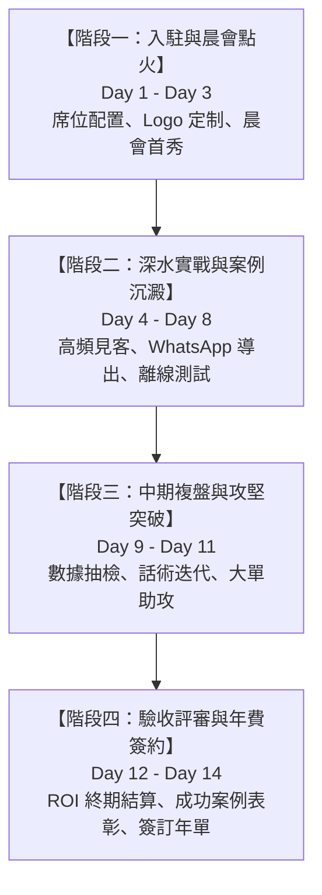
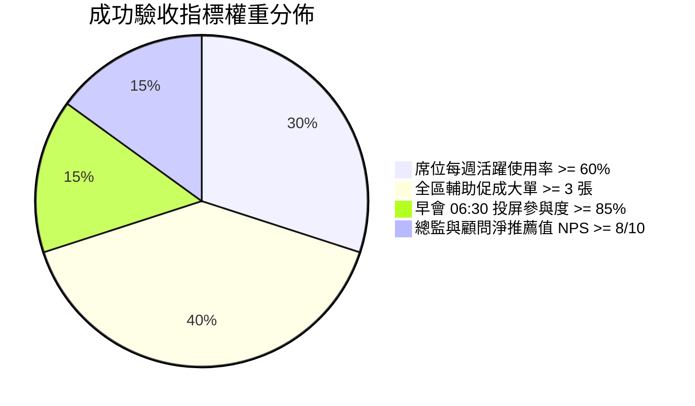

# InsurIntel HK: 三大營銷總監 14 天商業先導試點方案 (14-Day Pilot Plan)
## 先導區遴選標準、每日推進節奏、成功驗收指標、熔斷終止條件與年費鎖定閉環

> [!NOTE]
> **先導試點項目章程**：
> 本先導方案旨在與香港主流保險公司之 3 位代表性分區總監 (District Directors) 開展為期 14 天的封閉式深度商業試點，實地驗證「Top-Down 晨會同步 + 見客雙模攻防」在真實展業中的促成效能與投資回報率 (ROI)。

---

## 第一部分：三大試點分區遴選矩陣 (District Selection Matrix)

為確保試點結果在香港多元保險市場中具備廣泛代表性，設立三個先導試點席位（真實分區總監姓名、所屬分支機構及聯絡方式待項目所有者提供）：

| 試點分區代號 | 試點機構類別 | 目標團隊畫像 (待所有者指定) | 團隊主力業務險種 | 典型競品攻防痛點 | 試點預期戰略目標 |
| :---: | :---: | :--- | :--- | :--- | :--- |
| **Pilot Slot 1** (待所有者命名) | **主流專屬代理保司 A** (例如 AIA 營銷團隊) | 資深分區總監 · 約40-60人團隊 （包含新人與 MDRT 骨幹） | 多元貨幣儲蓄、終身重疾、自願醫保 | 遭遇競品高達 28% 首年宣傳回贈衝擊，客戶常在咖啡館質疑我方名義回贈較低。 | 驗證「保證回本年期 + GN16 官方實現率穩定性」客觀對照話術之實戰威力。 |
| **Pilot Slot 2** (待所有者命名) | **主流專屬代理保司 B** (例如 保誠 營銷團隊) | 菁英分區總監 · 約30-50人團隊 （包含港漂/跨境展業顧問） | 多元貨幣儲蓄、危疾加諾保、高端自願醫保 | 內地訪港旅客 (MCV) 佔比高，常需在高鐵西九龍站或尖沙咀海港城應對競品利率競爭。 | 驗證「MCV 跨境簽單合規指引 + 30秒離線極速對比」對異地大額保單之促成加速效果。 |
| **Pilot Slot 3** (待所有者命名) | **主流專屬代理保司 C 或 IFA** (例如 宏利/獨立經紀行) | 財富管理總監 · 約40-60人團隊 （主打中產家庭與退休年金） | 多元儲蓄、延期年金 (QDAP)、高端醫療 | 客戶高度關注預繳利率（5.5% 宣傳點）與私立醫院入院免找數 (LOG) 批核流程，面臨退稅質疑。 | 驗證「QDAP 累進稅階精算器 + 全港 13 家私院現金流按金對照表」對中產家庭市場之轉化力。 |

---

## 第二部分：14 天先導推進每日執行節奏 (Daily Cadence: Day 1 - Day 14)

### 階段一：快速入駐與晨會點火 (Day 1 - Day 3)
* **Day 1 (星期一)：席位部署與團隊 Logo 注入**
  * 09:00：為每個試點分區開通 20 個獨立 Advisor Pro 席位，後台完成 District 專屬 Logo 與總監執業名片壓印。
  * 14:00：由 InsurIntel 客戶成功總監 (CSM) 對各區核心主管與 MDRT 骨幹進行 45 分鐘線上實機培訓。
* **Day 2 (星期二)：06:30 晨會投屏首秀**
  * 06:30：晨會系統自動同步今日全港 15 家保司最新市場通函。
  * 08:30：總監在大屏幕上投屏 `dist/morning_slides.html`，按照 15 分鐘晨會講稿帶領全體顧問進行「首輪市場攻防演練」。
  * 指標卡點：全員 20 位顧問 100% 成功登入並保存手機 PWA 桌面圖示。
* **Day 3 (星期三)：首批意向客戶方案推送**
  * 顧問針對過去 30 天內猶豫未決的 3 位意向客戶，使用「一鍵導出 WhatsApp 促成話術」發送客觀精算對照。
  * 指標卡點：累計發出 $\ge 40$ 條合規對照話術。

### 階段二：深水實戰與見客對抗 (Day 4 - Day 8)
* **Day 4 (星期四)：咖啡館臨場極速對抗**
  * 顧問在中環、尖沙咀等咖啡館進行實機見客，切換「客戶客觀對照視角 (Client View)」，驗證 30 秒客觀對比壓制力。
* **Day 5 (星期五)：地鐵與地庫離線韌性抽檢**
  * 安排顧問在香港地鐵交匯站或地庫無網絡環境下模擬斷網操作，驗證 LocalStorage 本地離線精算穩定性。
* **Day 6 - Day 7 (週末)：跨境訪港旅客 (MCV) 會客實戰**
  * Pilot Slot 2 顧問團隊在高鐵西九龍站或商業會客區接待內地客戶，使用 MCV 跨境合規檢核表完成合規初審。
* **Day 8 (星期一)：第一週戰果小結晨會**
  * 總監主持晨會，邀請 2 位上週成功借助 InsurIntel 破冰的顧問進行 5 分鐘「實戰開單經驗分享」。

### 階段三：中期審計與大單攻堅 (Day 9 - Day 11)
* **Day 9 (星期二)：萬用壽險與保費融資利差壓力測試**
  * 針對大額融資客戶，實操動態利差滑塊（+100bps 至 +300bps 加息情景），消除高淨值客戶對利差倒掛的恐慌。
* **Day 10 (星期三)：合規官模擬抽檢與建議書 PII 脫敏審計**
  * 由經紀行/保司資深合規專家隨機抽檢 10 份顧問導出的分析記錄，確認 100% 符合 HKIA GL20 規範，建議書個人身份資訊 100% 脫敏。
* **Day 11 (星期四)：大額保單促成閉環加速**
  * 針對預計年化保費 $\ge \text{USD \$30,000}$ 的重點攻堅案例，InsurIntel 精算專家提供 1 對 1 高級精算對照支持。

### 階段四：終期驗收評審與商業簽約 (Day 12 - Day 14)
* **Day 12 (星期五)：全區數據統計與 ROI 測算**
  * 後台拉取 14 天活躍使用數據：累計查詢次數、客觀對照展頁時長、輔助促成保單數及產生之首年佣金 (FYC)。
* **Day 13 (星期六)：總監閉門複盤會**
  * 向 3 位分區總監出具《14天先導試點商業效益 tearsheet》，對比試點前後新人開單週期與成單率變化。
* **Day 14 (星期日)：轉化簽約與年繳續約**
  * 鎖定正式合約：簽約 1 年 Agency Team 方案（HK$24,800/年，免 2 個月月費），開具正式商業發票與 District 授權證書。

---

## 第三部分：試點成功量化驗收指標 (Success Metrics)

先導項目結束時，必須達到以下關鍵結果指標 (Key Results) 方可認定為試點成功：

1. **席位活躍覆蓋率 (Seat Adoption Rate)**：
   * **目標**：每個分區 20 個席位中，每週至少登入使用 3 次的活躍席位數 **$\ge 12$ 個（$\ge 60\%$ 活躍度）**。
2. **實戰促成轉化效果 (Closed Cases Assisted)**：
   * **目標**：試點 14 天內，每個分區**至少有 3 張長期保單**是在 InsurIntel 客觀數據對照輔助下正式簽單投保（3 區合計 $\ge 9$ 張保單）。
   * **保費與佣金指標**：累計輔助首年保費 (AFYP) $\ge \text{HK\$ 800,000}$，為團隊創造首年佣金 (FYC) $\ge \text{HK\$ 200,000}$。
3. **晨會投屏打卡率 (Morning Briefing Sync)**：
   * **目標**：試點期間 10 個工作日中，總監在早會大廳投屏 `dist/morning_slides.html` 的天數 **$\ge 8$ 天（$\ge 80\%$ 打卡率）**。
4. **用戶滿意度與推薦意願 (NPS)**：
   * **目標**：參與試點顧問與總監的淨推薦值問卷評分 **NPS $\ge 8.5 / 10$**；無任何一例客戶因「誤導宣傳」向保司提出申訴。

---

## 第四部分：試點熔斷與終止條件 (Kill Criteria)

若在先導進程中觸發以下任一底線紅線，**立即無條件終止該試點，並啟動工程與業務回滾機制**：

| 觸發編號 | 熔斷紅線指標 | 監測時間點 | 觸發後處置機制 |
| :---: | :--- | :---: | :--- |
| **KILL-01** | **席位活躍度極度低迷**：分區活躍席位率 $< 30\%$（20人中少於 6 人登入使用）。 | Day 7 (中點) | 暫停試點，召開 15 分鐘總監訪談；若團隊缺乏意願，提前終止並回收席位。 |
| **KILL-02** | **實戰零開單與零推進**：全區無任何意願客戶反饋，未產生任何一份實質促成對話。 | Day 10 | 評估是否屬於產品質量問題或話術適配問題；若兩次迭代仍無進展，判定該試點失敗。 |
| **KILL-03** | **監管合規一票否決**：顧問違規外傳戰鬥詞彙引發保司合規部警告，或發生客戶個人資料 (PII) 外洩。 | 任意時間 | **即刻全局熔斷**！吊銷該分區所有席位，封存雲端審計日誌，法務合規組介入覆核。 |
| **KILL-04** | **系統技術嚴重中斷**：離線 LocalStorage 崩潰或精算結果與保單條款出現重大偏差 ($> 2\%$ 誤差)。 | 任意時間 | 觸發技術熔斷器 (Circuit Breaker)，安全回滾至上一期基線版本，24 小時內修復修補。 |

---

## 第五部分：年費鎖定與續約商業閉環 (Annual Conversion Mechanism)

試點第 14 天達標後，推動區域總監平穩過渡至正式商業付費：

1. **先導專屬早鳥禮遇 (Pilot Early Bird Incentive)**：
   * 試點分區在第 14 天前確認簽署 1 年期合約，享受 **HK$24,800 / 年**（立省 2 個月月費 HK$4,960，折合每月僅 HK$2,066）。
   * 免費獲贈 **5 個額外專屬席位（擴容至 25 席位）**，為期 12 個月。
2. **總監專屬特權包 (District Director VIP Perks)**：
   * InsurIntel 每季度派精算師親臨該分區晨會，進行 1 小時線下「香港市場最新精算動態與促成秘訣」高階路演。
   * 團隊自訂 Logo 與專屬名片永久免收設置費。
3. **滿意保證與無憂條款 (Satisfaction Guarantee)**：
   * 承諾正式簽約後 30 天內，若團隊使用滿意度低於 80%，可按天無條件申請剩餘天數退款，徹底消除總監採購顧慮。
