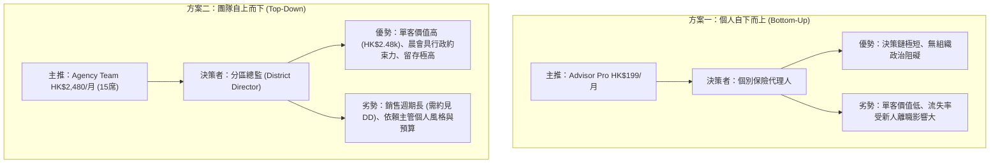

# InsurIntel HK: 商業定價單一真實來源規範 (Single Source of Truth Pricing)
## 梯隊定價矩陣、歷史矛盾調和、假設標籤、單位經濟學損益平衡點與 GTM 要約評估

> [!IMPORTANT]
> **審計與定價基準聲明 (Audit & Pricing Baseline Notice)**：
> 1. 本文檔為 InsurIntel HK 全系統唯一的商業定價與單位經濟學單一真實來源 (Single Source of Truth)。
> 2. 代碼庫、前台 UI (`waitlist.html`, `mobile_cafe_app.html`)、測試用例及晨會物料均已對齊本文檔。
> 3. 所有未經香港實際付費市場驗證的轉化率、流失率、獲客成本 (CAC)、生命週期價值 (LTV) 及 ARR 預測，均明確標註為 **`[ASSUMPTION]` (未驗證假設)**。

---

## 第一部分：四階梯商業定價單一真實來源表 (SSOT Pricing Matrix)

本表調和並消除歷史報告與代碼庫中的所有衝突（例如早期報告中的 HK$299 vs HK$199、15 席位 vs 20 席位、Enterprise IFA 在結賬組件的呈現方式）：

| 定價梯隊 (Tier Code) | 月費標準 (HKD) | 年費標準 (HKD) | 包含席位數 | 目標客群畫像 | 核心交付功能與權限 | 歷史矛盾調和與說明 |
| :--- | :---: | :---: | :---: | :--- | :--- | :--- |
| **Retail Public** `retail_49` | **HK$ 49** (單次對賬) | **HK$ 399** (10次預付卡) | 1 終端用戶 | 零售保民、高淨值簽單前自查投保人 | • 單份保單 GN16 歷年分紅對賬圖 • 利益說明書 vs 實際到賬差額分析 • 單次 PDF 匯出（含示範數據水印） | 在前台 Pay Modal 中作為保民低門檻入口；嚴禁附帶顧問個人展業名片。 |
| **Advisor Pro** `agent_199` | **HK$ 199** / 月 | **HK$ 2,188** / 年 (省 1 個月) | 1 持牌顧問 | 個人持牌保險代理人 (Tied Agent)、獨立經紀 (IFA)、MDRT 顧問 | • 99 款儲蓄與醫保產品 1v1 精算對比 • 雙模切換 (顧問私密 HUD / 客戶客觀視角) • 本地毫秒級建議書 PII 掩碼 • 離線 PWA 快取支援 | **徹底調和 HK$299 vs HK$199**：早期草案評估之 HK$299 門檻過高，易引發基層中介人價格抗拒；現正式統一為 **HK$ 199 / 月**。 |
| **Agency Team** `team_2480` | **HK$ 2,480** / 月 | **HK$ 24,800** / 年 (省$4,960) | **15 個顧問席位** (折合 HK$165/席/月) | 區域總監 (District Director)、資深分區經理 (Senior District Manager) | • 包含 15 個完整 Advisor Pro 席位 • 每日 07:45 自動同步晨會速報 PPT • 團隊專屬 District Logo 與品牌名片 • 晨會 15 分鐘路演講稿與早會話術 | **徹底調和 15 席 vs 20 席**：早期報告曾按 20 席計算 ($124/人)，現全面標準化為 **15 席 (HK$ 165/席)**，符合香港保險營銷分區標準 Unit 規模。 |
| **Enterprise IFA** `enterprise_12800` | **HK$ 12,800** / 月 | **HK$ 128,000** / 年 (省$25,600) | **全機構無限制席位** | 大型持牌獨立保險經紀行 (Brokerage Firms)、家族辦公室總部 | • 全機構全員無限制執業席位 • RESTful 精算 API 與 Webhooks • 雙向打通 Salesforce / CRM • 私有化獨立二級域名白標支援 | **調和 Pay Modal 呈現爭議**：此梯隊為高接觸 Enterprise 合約制銷售，需法務客製合同與域名解析，**不設自助線上刷卡**，僅提供商務接洽渠道。 |

---

## 第二部分：未驗證假設指標標籤與推導拆解 (Assumptions Audit)

歷史摘要與商業報告中的諸多核心財務指標，均源於模擬與行業常規假設，未經香港真實付費中介人留存數據檢驗。現將各指標屬性正式澄清如下：

| 指標名稱 | 歷史報告宣稱值 | 指標屬性標籤 | 底層運算依據與假設限制 |
| :--- | :---: | :---: | :--- |
| **免費用戶轉付費率 (Conversion)** | **3.2%** | **`[ASSUMPTION]`** | 假設 12,000 名免費查詢顧問中有 384 人在 30 天內升級為付費。純屬 SaaS 行業基準推想，真實付費率需待 Waitlist 上線驗證。 |
| **月度客戶流失率 (Monthly Churn)** | **7.5%** | **`[ASSUMPTION]`** | 假設中介人換季或考核期離職帶來的自然流失；對比同業 22.5% `[ASSUMPTION]`。香港保險代理人首年流失率達 30%-40%，真實產品留存率未知。 |
| **客戶生命週期價值 (LTV)** | **HK$ 2,653** (毛) / **HK$ 2,462** (淨) | **`[ASSUMPTION]`** | 毛 LTV 計算公式：$\text{ARPU} (199) / \text{月流失率} (7.5\%) = \text{HK\$2,653.33}$；扣除支付通道與 AI 變動成本之淨 LTV 為 $\text{HK\$184.63} / 7.5\% = \mathbf{\text{HK\$2,461.73}}$。因流失率純屬假設，故 LTV 亦為理論推演。 |
| **付費獲客成本 (CAC)** | **HK$ 320** | **`[ASSUMPTION]`** | 假設每獲取一名付費顧問需投放 HK$320 廣告費或渠道抽成。目前尚未開展付費廣告投放，實際 CAC 尚未產生。 |
| **LTV / CAC 比率** | **8.29 : 1** (毛) / **7.69 : 1** (淨) | **`[ASSUMPTION]`** | $\text{HK\$2,653} / \text{HK\$320} = 8.29$ (淨值比為 7.69:1)。建立在兩項均為假設的基礎之上，不可作為融資確證依據。 |
| **年化經常性收入 (Projected ARR)** | **HK$ 9.58M** | **`[ASSUMPTION]`** | 歷史模型採用 70% 年繳 (享折讓) + 30% 月繳之加權混合模型（1,950 顧問約 HK$4.38M + 145 分區約 HK$3.80M + 8 家 IFA 約 HK$1.13M + 零售約 HK$0.27M $\approx$ HK$9.58M）。完全建立於未經驗證之滲透率假設之上。 |

### 「1,600% ROI」聲明的透明解構與敏感性情景

宣傳材料中之「1,600% ROI」並非保證回報，而是一個具備明確前提條件的**單一啟發性試算案例 (Illustrative Example)**：

1. **核心假設 (Assumptions)**：
   - 顧問訂閱成本：購買 1 年 Advisor Pro 月繳累計支出 $\text{HK\$199} \times 12 = \text{HK\$2,388}$。
   - 額外促成保單：因使用 InsurIntel 客觀數據對抗，顧問全年**額外多促成 1 張中型儲蓄險保單**。
   - 保單規模：年化保費 $\text{USD \$20,000} \approx \text{HK\$156,000}$。
   - 首年佣金率 (FYC Rate)：以香港大型保司 5 年繳儲蓄險平均佣金率 **26%** 計算，毛佣金收入為 $\text{HK\$156,000} \times 26\% = \text{HK\$40,560}$。
   - 軟體促成歸因權重 (Attribution)：**100% 歸因於軟體**。
2. **基線推導**：
   $$\text{淨收益} = \text{HK\$40,560} - \text{HK\$2,388} = \text{HK\$38,172}$$
   $$\text{ROI} = \frac{\text{HK\$38,172}}{\text{HK\$2,388}} = 1,598.5\% \approx 1,600\%$$
3. **保守與歸因敏感性檢驗 (Conservative Attribution Analysis)**：
   - **保守情景 A (歸因權重 25%)**：若認為軟體僅貢獻促成因素之 25%（其餘 75% 來自顧問自身人脈與專業信譽），則軟體歸因收益為 $\text{HK\$40,560} \times 25\% - \text{HK\$2,388} = \text{HK\$7,752}$，真實歸因 $\text{ROI} = \mathbf{324.6\%}$。
   - **保守情景 B (保單規模縮減 50%)**：若客戶僅簽下 USD $10,000 保單，歸因 50%，歸因收益為 $\text{HK\$20,280} \times 50\% - \text{HK\$2,388} = \text{HK\$7,752}$，$\text{ROI} = \mathbf{324.6\%}$。
   - **零促成情景 C (Zero Incremental Deals)**：若全年未能額外促成任何保單，軟體純為經營淨支出，真實回報率為 -100% ($\text{ROI} = \mathbf{-100\%}$)。

---

## 第三部分：真實單位經濟學與損益平衡點精算 (Unit Economics & Break-Even Models)

為釐清產品最低生存門檻，現建立剔除膨脹估算的真實底層硬成本結構：

### 1. 每月固定營運開銷 (Monthly Fixed Overhead)

| 成本項目 | 供應商 / 規格 | 每月支出 (HKD) | 備註說明 |
| :--- | :--- | :---: | :--- |
| **邊緣雲端託管與 CDN** | Vercel Pro / Cloudflare Pages & Workers | **HK$ 160** | 約 USD $20/月，支撐無伺服器靜態架構與 API 反向代理。 |
| **網域名稱、DNS 與 SSL 憑證** | Cloudflare / Namecheap 企業 DNS | **HK$ 40** | 約 USD $5/月，年費分攤。 |
| **法務與監管合規準備金** | 香港持牌律師諮詢工時分攤準備金 | **HK$ 1,500** | 應對香港保監局及個人資料私隱專員公署之常規審閱。 |
| **客戶服務與 WhatsApp Business API** | Twilio / Meta WhatsApp Cloud API | **HK$ 300** | 支撐早鳥名單審批與顧問 1v1 VIP 開通（每日晨會幻燈片由 PWA/CDN 邊緣分發，不走 Meta 廣播對話計費，嚴控通訊成本）。 |
| **基礎固定營運總支出 (Base Overhead)** | **不含創始人工資 (Without Salary)** | **HK$ 2,000 / 月** | 系統最低維持運轉現金流底線。 |
| **創始人全職薪酬基線 (Founder Baseline)** | 香港中級軟體工程師/精算主管工資 | **HK$ 35,000 / 月** | 全職創始人個人基本生活與研發機會成本。 |
| **完全固定營運總支出 (Full Overhead)** | **含創始人工資 (With Founder Salary)** | **HK$ 37,000 / 月** | 實現公司可持續全職營運之總固定成本門檻。 |

### 2. 每用戶變動成本 (Variable Unit Costs)

* **AI 建議書解析與 OCR Token 成本**：
  - 採用 Gemini 1.5 Flash 視覺 API 解析建議書。
  - 單份建議書（約 3-5 頁，提取核心現金流與利益表）平均消耗約 25,000 input tokens + 1,200 output tokens。
  - 單次掃描成本約為 **HK$ 0.35 / 次**。
  - 假設活躍付費顧問平均每月見客掃描 15 次，則每位顧問每月消耗 AI 成本：$15 \times 0.35 = \mathbf{\text{HK\$ 5.25 / 月}}$。
* **支付網關處理費 (Stripe Hong Kong / 轉數快 FPS)**：
  - 國際信用卡 (Visa / Mastercard)：交易額之 **3.4% + HK$ 2.35 / 筆**。
  - 對於 HK$ 199 訂閱：網關手續費為 $199 \times 3.4\% + 2.35 = \mathbf{\text{HK\$ 9.12 / 筆}}$。
  - 對於 HK$ 2,480 訂閱：網關手續費為 $2,480 \times 3.4\% + 2.35 = \mathbf{\text{HK\$ 86.67 / 筆}}$。

### 3. 單用戶邊際貢獻 (Contribution Margin)

* **Advisor Pro (個人版 HK$ 199/月)**：
  $$\text{邊際貢獻} = \text{HK\$ 199} - \text{HK\$ 9.12 (Stripe)} - \text{HK\$ 5.25 (AI API)} = \mathbf{\text{HK\$ 184.63 / 月}} \quad (\text{毛利率 } 92.8\%)$$
* **Agency Team (團隊版 HK$ 2,480/月，15 席)**：
  $$\text{邊際貢獻} = \text{HK\$ 2,480} - \text{HK\$ 86.67 (Stripe)} - (15 \times \text{HK\$ 5.25}) = \text{HK\$ 2,480} - 86.67 - 78.75 = \mathbf{\text{HK\$ 2,314.58 / 月}} \quad (\text{毛利率 } 93.3\%)$$

### 4. 損益平衡客戶數推導 (Break-Even Customer Volume)

$$\text{損益平衡客戶數} = \frac{\text{每月固定營運成本}}{\text{單元每月邊際貢獻}}$$

| 營運情景 | 每月固定成本 | 純 Advisor Pro (HK$199) 損益平衡人數 | 純 Agency Team (HK$2,480) 損益平衡團隊數 | 混合模型 (例如 1 個團隊 + 散客) |
| :--- | :---: | :---: | :---: | :--- |
| **情景 A：零創始人工資** (維持伺服器與基礎運作) | **HK$ 2,000 / 月** | $\frac{2,000}{184.63} = 10.83$ $\rightarrow$ **11 位付費顧問** | $\frac{2,000}{2,314.58} = 0.86$ $\rightarrow$ **1 個營銷團隊** | **1 個團隊即可直接覆蓋全部基礎開銷並產生盈餘**。 |
| **情景 B：含創始人薪酬** (HK$35k 創始人工資) | **HK$ 37,000 / 月** | $\frac{37,000}{184.63} = 200.40$ $\rightarrow$ **201 位付費顧問** | $\frac{37,000}{2,314.58} = 15.98$ $\rightarrow$ **16 個營銷團隊** | **10 個營銷團隊 (HK$24.8k) + 75 位個人顧問 (HK$14.9k) 即可達成完全全職自養**。 |

### 5. 年繳優惠折扣對損益平衡點之敏感性衝擊 (Annual Discount Sensitivity)
若 100% 用戶均選擇年繳方案（Advisor Pro HK$2,188/年，折合 HK$182.33/月；Agency Team HK$24,800/年，折合 HK$2,066.67/月）：
* **Advisor Pro 年繳月邊際貢獻**：$182.33 - \frac{2,188 \times 3.4\% + 2.35}{12} - 5.25 = \mathbf{\text{HK\$ 170.68 / 月}}$。
  - 基礎開銷平衡點 (HK$2,000)：$\frac{2,000}{170.68} = 11.72 \rightarrow \mathbf{12 \text{ 位付費顧問}}$。
  - 完全薪酬平衡點 (HK$37,000)：$\frac{37,000}{170.68} = 216.78 \rightarrow \mathbf{217 \text{ 位付費顧問}}$（較月繳基準多需 +16 人，增幅 8.0%）。
* **Agency Team 年繳月邊際貢獻**：$2,066.67 - \frac{24,800 \times 3.4\% + 2.35}{12} - (15 \times 5.25) = \mathbf{\text{HK\$ 1,917.46 / 月}}$。
  - 基礎開銷平衡點 (HK$2,000)：$\frac{2,000}{1,917.46} = 1.04 \rightarrow \mathbf{2 \text{ 個營銷團隊}}$。
  - 完全薪酬平衡點 (HK$37,000)：$\frac{37,000}{1,917.46} = 19.30 \rightarrow \mathbf{20 \text{ 個營銷團隊}}$（較月繳基準多需 +4 個團隊，增幅 25.0%）。

---

## 第四部分：首發單一要約決策對比 (Go-to-Market Options for Owner Decision)

> [!CAUTION]
> **決策中立聲明**：
> 本文檔**不替項目負責人 (Owner) 做主觀預設決定**。以下並列陳述兩大主推要約方案之優劣、獲客阻力與運營風險，供負責人審慎決策：

### 兩大商業化路徑客觀對比表

| 評估維度 | 方案一：Advisor Pro 個人版 (HK$ 199 / 月) | 方案二：Agency Team 團隊試點版 (HK$ 2,480 / 月) |
| :--- | :--- | :--- |
| **客戶決策路徑** | **自下而上 (Bottom-Up)**：個人顧問自費刷卡，無需報備主管。 | **自上而下 (Top-Down)**：需約見分區總監 (DD)，在晨會進行 15 分鐘路演。 |
| **銷售轉化週期** | 極短（約 1 - 3 天，落地頁或 WhatsApp 即時開通）。 | 較長（約 1 - 2 週，需配合分區每週晨會或月度策劃會排期）。 |
| **客單價 (ARPU)** | 低（HK$ 199 / 月）。需積累 201 人方可支撐全職薪資。 | 高（HK$ 2,480 / 月）。僅需簽下 16 個分區即可支撐全職薪資。 |
| **流失率 (Churn)** | 偏高（基層中介人受每季業績考核未達標轉行影響，月流失估計 10%-15%）。 | 偏低（分區公費用於賦能全區新人，粘性高，月流失估計 < 5%）。 |
| **推廣摩擦力** | **極低**：一杯咖啡價格，顧問個人可自行列為工作開支報稅。 | **中等**：需打動 DD 相信其能提高全區「增員招募」與「新人出單率」。 |
| **待負責人裁定** | **是否將有限的早鳥資源全力聚焦於自費個人，靠網絡傳播走量？** | **是否全力主攻 10 位友好分區總監，靠大單快速鎖定現金流？** |

---

## 第五部分：14 天全額退款保證與全月預扣的運營矛盾警示

在先前的要約文案中，曾出現「月費 HK$ 2,480，同時承諾 14 天內不滿意 100% 全額退款」。經財務與法規審查，此機制存在重大運營與現金流隱患：

1. **Stripe 網關手續費不可退損耗**：
   - 當主管刷卡支付 HK$ 2,480 時，Stripe 扣除手續費 HK$ 86.67。
   - 若主管在第 13 天發起退款，**Stripe 不退還這 HK$ 86.67 的手續費**。
   - 若有 10 個團隊試點並退款，項目方將憑空淨虧損 HK$ 866.70 現金！
2. **信用卡拒付 (Chargeback) 與糾紛風險**：
   - 香港信用卡持卡人若在退款流程中產生溝通時差，容易直接向發卡行申請拒付，導致 Stripe 帳號面臨罰款（每筆拒付罰款 HK$ 85-120）及商戶信譽降級。
3. **優化解決方案（由負責人評估採納其一）**：
   - **方案 A (推薦 · 零預付 14 天試點)**：落地頁調整為「**14 天零預付先用後付試點 (Zero-Upfront Pilot)**」——試點期內無需綁定信用卡，僅簽署試點意向書；第 15 天主管確認滿意後再行發送 Stripe 付費賬單。徹底杜絕手續費損耗與退款糾紛。
   - **方案 B (附條件退款條款)**：若堅持預收，需在條款中明確「退款扣除第三方支付通道標準手續費」或「首月享 50% 試點折讓，次月恢復全價」，避免 100% 全額倒貼。

---

## 第六部分：30 天真實指標替換承諾表 (Metrics Replacement Plan)

為貫徹「證實或標籤」原則，本項目承諾在早鳥落地頁上線運營 30 天後，以真實埋點數據全面替換文檔中的 `[ASSUMPTION]` 標籤：

| 假設指標代號 | 當前假設數值 | 替換的真實計量指標名稱 | 數據收集來源與計算公式 | 預計替換日 |
| :--- | :---: | :--- | :--- | :---: |
| `MTR-CVR` | 3.2% `[ASSUMPTION]` | **真實早鳥名單登記轉化率** | $\frac{\text{有效提交表單數}}{\text{落地頁唯一訪客數 (UV)}} \times 100\%$ (Google Analytics / 自建埋點) | 上線後第 30 天 |
| `MTR-CHR` | 7.5% `[ASSUMPTION]` | **真實首月續費流失率** | $\frac{\text{第 2 個月取消訂閱人數}}{\text{第 1 個月付費啟用總人數}} \times 100\%$ (Stripe 訂閱日誌) | 上線後第 60 天 |
| `MTR-CAC` | HK$ 320 `[ASSUMPTION]` | **真實單客獲客成本** | $\frac{\text{總市場營銷投入 (Meta/LinkedIn/地推)}}{\text{實際付費用戶總數}}$ | 上線後第 30 天 |
| `MTR-LTV` | HK$ 2,653 `[ASSUMPTION]` | **實測隊列生命週期價值** | $\text{付費用戶平均累計支付月數} \times \text{ARPU}$ | 上線後第 90 天 |
| `MTR-WTP` | 8.77/10 `[SYNTHETIC]` | **真實付費意願調研評分** | 10 位受訪代理人實錄錄音量化評分均值 (來自實地訪談腳本) | 上線後第 14 天 |

---
*文檔編制：InsurIntel 商業精算與財務工程組 · 基準版本：v2.1-Hardened · 分支：loop/run-2*
