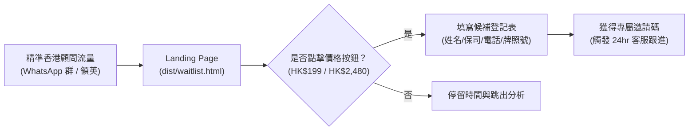
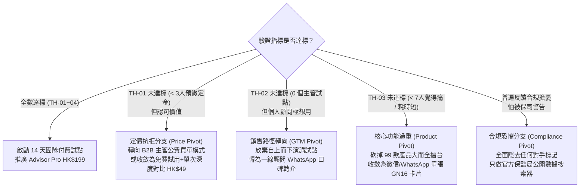

# InsurIntel HK: 市場真實付費意願驗證計劃與 10 顧問行為訪談指南
## Fake-Door Landing Page Protocol, Past-Behavior Cantonese Interview Script, Success Thresholds & Pivot Rules

> [!NOTE]
> **方法論聲明 (The Mom Test Framework)**：
> 絕大部分 SaaS 產品夭折於「問客戶未來願不願意用，客戶禮貌說好，但上線後沒人付錢」。
> 本驗證方案嚴格依據 Rob Fitzpatrick《The Mom Test》原則設計：**完全不問假設性問題（絕無「如果市面上有個工具...你會唔會用？」等推銷話術），只深挖過去 30 天內的真實行為、時間耗費、已發生的金錢支付與成交結果**。

---

## 第一部分：Fake-Door 假門測試落地頁驗證規範

已編譯單頁面落地頁：[`dist/waitlist.html`](file:///C:/Users/rain2/Downloads/agent_test/dist/waitlist.html)

### 假門測試核心監控指標：
1. **訪客至登記轉化率 (Visitor-to-Waitlist Rate)**：
   - 定義：填寫姓名、所屬保司、WhatsApp 聯絡電話並點擊「立即鎖定 14 天免費試用名額」的獨立訪客比例。
   - 基準假設目標：$\ge 8.0\%$。
2. **定價階梯意向偏好 (Tier Selection Distribution)**：
   - 記錄下拉框選擇分佈：`AdvisorPro_HKD199` vs `AgencyTeam_HKD2480`（與落地頁實際選項 100% 保持一致）。
3. **真實預約金承諾率 (Deposit Commitment Rate)**：
   - 客服在 WhatsApp 聯絡登記顧問時，提出：「透過轉數快 (FPS) / PayMe 支付 HK$50 可優先解鎖首批名額，14 天不滿意全額無條件秒退」，以真實金錢承諾代替口頭吹捧。

---

## 第二部分：10 位一線香港保險顧問深訪指南 (Cantonese Past-Behavior Script)

### 訪談抽樣原則與渠道隔離：
* **專屬代理人 (Tied Agents)**：覆蓋 AIA 友邦、Prudential 保誠、Manulife 宏利等大保司。注意：專屬代理人受保司《代理人合約》與保監局合規嚴格監管，公眾場合晨會通常不可公開展示未授權第三方對比單張，因此重點驗證其作為**個人後台算力輔助與精算速查學習工具**之價值。
* **獨立經紀行 / 財務策劃師 (Brokers / IFA)**：覆蓋專注於多保司貨比三家的高淨值中介團隊，重點驗證其對客中立撕頁 (Tear-Sheet) 與跨保司大擂台之採購意向。
* **年資與職級分層**：5 位 1–3 年新人 / 中生代，3 位 MDRT/COT 頂尖顧問，2 位分區總監 / 團隊主管 (District Director / Unit Manager)。
* **時間長度**：每人 20–25 分鐘，於咖啡館或電話錄音訪談。

---

### 模塊一：喚醒最近一次真實競品撞單經歷 (Past Collision Scenario)
> 目的：抓取真實展業痛苦，而非大腦美化的理論場景。

* **問題 1.1**：「回想下你最近 30 日入面，最近嗰一次遇到客戶攞住第二間保司嘅計劃書或者宣傳單張嚟問你，嗰張單具體係咩情況？係儲蓄、重疾定醫保？」
* **問題 1.2**：「當時個客第一句同你講咗啲咩？佢指住對手份 proposal 嘅邊個數字嚟挑戰你？」
* **問題 1.3**：「你當時聽到個客咁問，你內心第一反應係點？你口頭上第一句點應佢？」

---

### 模塊二：還原具體比較行為與時間成本 (Actual Behavior & Time Spent)
> 目的：衡量解決這個問題的真實價值與痛苦程度。

* **問題 2.1**：「返到屋企或者返到公司之後，你具體係點樣做呢兩份計劃書嘅比較嘅？
  - A) 自己開 Excel 一格格入數字計 IRR？
  - B) 搵同事 / 翻內部培訓 PPT / 翻 WhatsApp 微信群搵攻防圖？
  - C) 打電話問你嘅 Team Leader 或者熟嘅精算同行？」
* **問題 2.2**：「由你收到個客份對手 proposal，到你整好一份你可以自信拎去見個客嘅對比材料，你前後總共耗費咗幾多個鐘頭？」
* **問題 2.3**：「喺做對比嘅過程入面，最卡住你、最令你頭痛嘅係邊個部分？（例如：搵唔到對手嘅非保證分紅條款、唔知對手真實紅利實現率、定係計唔清保證回本年期？）」
* **問題 2.4 (合規敏感度)**：「平時你準備呢啲競品對比材料嗰陣，保司合規部或者團隊主管有冇提醒過咩條例？你自己見客嗰陣點樣拿捏《長期保單轉保指引》(GL27) 同守則嘅界線？」

---

### 模塊三：見客現場反饋與成交結果 (Presentation & Final Result)
> 目的：驗證傳統應對手段的無效率與客戶流失根源。

* **問題 3.1**：「當你帶住你準備好嘅材料第二次見個客，你具體點樣同佢講？個客聽完之後嘅反應係點？」
* **問題 3.2**：「喺對話過程入面，個客有冇對你講嘅嘢產生懷疑？佢有冇話『但人哋保誠/友邦個 Agent 唔係咁講喎』？」
* **問題 3.3**：「嗰張單最後嘅結果係點？
  - A) 成功簽單？（年繳幾多？簽咗邊款？）
  - B) 個客話『我再考慮下』然後就冇咗下文？
  - C) 個客最後簽咗對手嗰份？」
* **問題 3.4**：「如果嗰張單冇簽成，你平心而論，最核心嘅卡點係卡喺邊度？」

---

### 模塊四：歷史付費工具習慣與實際預約金檢視 (Historical Spend & Real Currency Commitment)
> 目的：用「過去真實掏腰包證據」與「即時真金定金」驗證真實商業價值，絕不進行假設性定價問卷。

* **問題 4.1 (回溯歷史付費)**：「過去 12 個月入面，為咗幫自己展業、見客、計數或者提升效率，你有冇自費掏荷包買過任何第三方軟件、收費資料庫或進修培訓？
  - 若有：具體買咗邊款？年費或月費大概幾多？當時係咩具體場景令你覺得非買不可？
  - 若無：過去遇到複雜精算或對比卡點嗰陣，你主要依靠咩免費路徑解決？有冇曾經因為冇合適工具而導致失單？」
* **問題 4.2 (最近一次自救成本)**：「最近嗰次整對比計劃書搞咗幾粒鐘嗰陣，你有冇諗過使錢請行政助理、買第三方報價軟件代勞？當時點解選擇自己熬夜硬啃？」
* **問題 4.3 (訪談結尾真金承諾檢驗)**：「我哋團隊下個月會開展首批 10 位資深顧問封閉式內測。為確保席位真實有效，需以轉數快 (FPS) 預繳 HK$50 優先鎖定金（若產品在 14 天內未能為你節省見客備戰時間，將無條件全額即時退款；若滿意可直接抵扣首月 HK$199 月費）。你現在是否願意直接確認名額？」
  - *記錄真實動作：即場付費 / 提供正式保監局牌照編號登記 / 找藉口推搪。*

---

## 第三部分：量化驗證成功指標 (Success Thresholds)

在完成 10 位顧問訪談與 100 位 Landing Page 登記線索後，按以下硬性閾值評定市場驗證結果（無任何廉價承諾漏洞）：

| 指標編號 | 驗證指標 (Validation Metric) | 成功達標線 (Success Threshold) | 數據採集來源 | 狀態定義 |
| :--- | :--- | :--- | :--- | :--- |
| **TH-01** | **真金預繳定金意向** | **$\ge 3 / 10$ 位顧問**以轉數快/PayMe 即場預付 HK$50 定金或提交正式持牌中介人登記編號 | 10 位顧問 1v1 訪談實錄與收款憑據 | 核心硬指標 |
| **TH-02** | **主管封閉小組試點** | **$\ge 1$ 位分區總監/團隊主管**確認安排其核心小組 (5+顧問) 進行 14 天封閉式業務沙盒試點 | 總監主管專訪確認記錄 | B2B 團隊槓桿指標 |
| **TH-03** | **撞單痛苦強烈度** | **$\ge 7 / 10$ 位顧問**在過去 30 天內至少遇到 1 次競品撞單且單次對比耗時 $> 2$ 小時 | 訪談模塊一、二實錄 | 痛點剛需指標 |
| **TH-04** | **Landing Page 假門轉化率** | 針對香港保險中介人群體定向流量，**登記轉化率 $\ge 8.0\%$** | `dist/waitlist.html` 埋點統計 | 漏斗前端指標 |

---

## 第四部分：未達標決策調整規則 (Pivot Decision Rules)

若 10 位顧問訪談或假門測試結果未達上述成功指標，嚴格執行以下無死角決策路徑，絕不盲目堆砌代碼：

### 具體調優動作清單：
1. **若遇到「定價抗拒 (Price Resistance)」(TH-01 < 3)**：
   - 表現：顧問認可工具實用，但習慣保司免費內部資源，不願自費掏 $199/月。
   - 應對動作：將 GTM 策略完全收斂至 **District Director / Unit Manager 團隊買單**（主管以團隊發展基金公費採購 HK$2,480/月，下發給下屬使用），或改為 **「基礎功能免費 + 深度算力對比單次付費 HK$49」**。
2. **若遇到「主管合規顧慮」(TH-02 = 0)**：
   - 表現：保司專屬代理人團隊主管擔心合規審查，不願在正式晨會推廣外部工具。
   - 應對動作：退回「封閉式非公開研究小組」，產品界面隱去任何客戶展示模式，僅保留後台演算法「精算師個人助手」模式。
3. **若遇到「痛點強度不足」(TH-03 < 7)**：
   - 表現：顧問覺得很少撞單，或者主要靠私訊前輩解決，不願花時間學習新軟件。
   - 應對動作：全面收縮產品線，砍掉複雜的 5 大類別、99 款產品矩陣，收斂為極致輕量化的「30 秒 WhatsApp 即享 GN16 達成率速查卡片」。
4. **若遇到「保司品牌忠誠或違規恐懼」(Compliance Friction)**：
   - 表現：專屬代理人 (Tied Agent) 擔心觸犯保監局《長期保單轉保指引》(GL27) 或保司內部紀律。
   - 應對動作：強化客戶視角之「香港保監局 GN16 / GL16 公開數據客觀披露」屬性，嚴格禁止任何引導退保或貶損特定保司言論，所有輸出物強制附帶「本對比僅供持牌中介人專業參考，不構成任何替換保單之建議」之法定中立免責條款。
