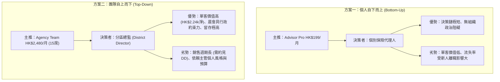

# InsurIntel HK: 商業定價單一真實來源規範 (Single Source of Truth Pricing)
## 雙要約首發矩陣、歷史矛盾調和、假設標籤、程式化損益平衡點與 GTM 要約評估
> **審計與定價基準聲明 (Audit & Pricing Baseline Notice)**：
> 1. 本文檔為 InsurIntel HK 全系統唯一的商業定價與單位經濟學單一真實來源 (Single Source of Truth)。
> 2. 首發測試**僅推出 2 個主推要約方案**（Advisor Pro 個人版 與 Agency Team 團隊版），其餘梯隊列為後續評估。
> 3. 所有損益平衡數據由 [`scripts/compute_break_even.js`](file:///c:/Users/rain2/Downloads/agent_test/scripts/compute_break_even.js) 程式化讀取成本表嚴格計算，杜絕手動拼湊。
> 4. 所有未經香港實際付費市場驗證的轉化率、流失率、獲客成本 (CAC)、生命週期價值 (LTV) 及 ARR 預測，均明確標註為 **`[ASSUMPTION]` (未驗證假設)**。

---

## 第一部分：首發雙主推定價要約與後續梯隊規範 (SSOT Launch Pricing Matrix)

本規範調和並消除歷史報告與代碼庫中的所有衝突（例如早期報告中的 HK$299 vs HK$199、15 席位 vs 20 席位、06:30 vs 07:45 早會同步時間）：

### 1. 首發主推 2 大要約 (The 2 Core Launch Options)

| 定價要約 (Launch Tier) | 月費標準 (HKD) | 年費標準 (HKD) | 包含席位數 | 目標客群畫像 | 核心交付功能與權限 | 歷史矛盾調和與說明 |
| :--- | :---: | :---: | :---: | :--- | :--- | :--- |
| **首發方案一：Advisor Pro** `agent_199` | **HK$ 199** / 月 | **HK$ 2,188** / 年 (省 1 個月) | **1 持牌顧問席位** | 個人持牌保險代理人 (Tied Agent)、獨立經紀 (IFA)、MDRT 顧問 | • 儲蓄與醫保產品 1v1 精算對比 • 雙模切換 (顧問私密提詞 / 客戶客觀視角) • 本地建議書 PII 掩碼 • 離線 PWA 快取支援 | **調和 HK$299 vs HK$199**：早期草案評估之 HK$299 門檻過高，現正式統一為 **HK$ 199 / 月**。 |
| **首發方案二：Agency Team** `team_2480` | **HK$ 2,480** / 月 | **HK$ 24,800** / 年 (省$4,960) | **15 個顧問席位** (折合 HK$165/席/月) | 區域總監 (District Director)、資深分區經理 (Senior District Manager) | • 包含 15 個完整 Advisor Pro 席位 • **每日 07:00 HKT 自動同步晨會投影片** • 團隊專屬 District Logo 與品牌名片 • 晨會 15 分鐘路演講稿與早會話術 | **調和 15 席 vs 20 席 & 同步時間**：標準化為 **15 席 (HK$ 165/席)**；晨會投影片由 06:30 編譯並於 **07:00 HKT** 完成離線預載，確保 08:30 早會順暢使用。 |

### 2. 後續評估梯隊聲明 (Roadmap Tiers - Post-Launch Evaluation)

* **Retail Public (`retail_49` - 單次對賬 HK$ 49 / 10次預付卡 HK$ 399)**：
  - *狀態*：首發階段暫不主動推廣，僅在產品驗證後期視一般投保人自然流量開啟，不列為當前首發銷售承諾。
* **Enterprise IFA (`enterprise_12800` - 全機構無限制席位 HK$ 12,800 / 月)**：
  - *狀態*：此梯隊為高接觸 Enterprise 合約制銷售，需法務客製合同與域名解析，**不設線上自助結賬 (Pay Modal)**。待完成首期 10 場代理人訪談並具備穩定交付能力後再行開放洽談。

---

## 第二部分：未驗證假設指標標籤與推導拆解 (Assumptions Audit)

歷史摘要與商業報告中的諸多核心財務指標，均源於模擬與行業常規假設，未經香港真實付費中介人留存數據檢驗。現將各指標屬性正式澄清如下：

| 指標名稱 | 歷史報告宣稱值 | 指標屬性標籤 | 底層運算依據與假設限制 |
| :--- | :---: | :---: | :--- |
| **免費用戶轉付費率 (Conversion)** | **3.2%** | **`[ASSUMPTION]`** | 假設 12,000 名免費查詢顧問中有 384 人在 30 天內升級為付費。純屬 SaaS 行業基準推想，真實付費率需待 Waitlist 上線驗證。 |
| **月度客戶流失率 (Monthly Churn)** | **7.5%** | **`[ASSUMPTION]`** | 假設中介人換季或考核期離職帶來的自然流失；對比同業 22.5% `[ASSUMPTION]`。香港保險代理人首年流失率達 30%-40%，真實產品留存率未知。 |
| **客戶生命週期價值 (LTV)** | **HK$ 2,653** (毛) / **HK$ 2,398** (淨) | **`[ASSUMPTION]`** | 毛 LTV 計算公式：$\text{ARPU} (199) / \text{月流失率} (7.5\%) = \text{HK\$2,653.33}$；扣除支付通道與變動成本 ($10.00) 之淨 LTV 為 $\text{HK\$179.88} / 7.5\% = \mathbf{\text{HK\$2,398.40}}$。因流失率純屬假設，故 LTV 亦為理論推演。 |
| **付費獲客成本 (CAC)** | **HK$ 320** | **`[ASSUMPTION]`** | 假設每獲取一名付費顧問需投放 HK$320 廣告費或渠道抽成。目前尚未開展付費廣告投放，實際 CAC 尚未產生。 |
| **LTV / CAC 比率** | **8.29 : 1** (毛) / **7.50 : 1** (淨) | **`[ASSUMPTION]`** | $\text{HK\$2,653} / \text{HK\$320} = 8.29$ (淨值比為 7.50:1)。建立在兩項均為假設的基礎之上，不可作為融資確證依據。 |
| **年化經常性收入 (Projected ARR)** | **HK$ 9.58M** | **`[ASSUMPTION]`** | 歷史模型採用加權混合滲透率推想。完全建立於未經驗證之滲透率假設之上。 |
| **香港前五大旗艦覆蓋率宣稱** | **宣稱「覆蓋 75% APE 份額與 80% 場景」** | **`[ASSUMPTION - 歷史未驗證宣稱]`** | **已從正式交付物中廢除**。在未取得保監局正式季度 APE 統計明細前，該市場份額數字純屬中介人口頭估測。正式首發核實產品名單統一調和為香港主流 5 款儲蓄險：友邦 (AIA) 盈御 3、保誠 (Prudential) 雋富、宏利 (Manulife) 宏摯、富衛 (FWD) 盈豐、永明 (Sun Life) 萬年青 (Stellar)，並以安盛 (AXA) 盛世傳承作為第 6 款備選方案。 |

### 「1,600% 投資回報率 (ROI)」假設聲明的透明解構與敏感性情景

歷史材料中之「1,600% 投資回報率 (ROI)」並非保證回報，而是一個具備明確前提條件的**單一啟發性試算案例 (Illustrative Example)** `[ASSUMPTION]`：

1. **核心假設 (Assumptions)**：
   - 顧問訂閱成本：購買 1 年 Advisor Pro 月繳累計支出 $\text{HK\$199} \times 12 = \text{HK\$2,388}$。
   - 額外促成保單：因使用 InsurIntel 客觀數據對抗，顧問全年**額外多促成 1 張中型儲蓄險保單**。
   - 保單規模：年化保費 $\text{USD \$20,000} \approx \text{HK\$156,000}$。
   - 首年佣金率 (FYC Rate)：以香港大型保司 5 年繳儲蓄險平均佣金率 **26%** 計算，毛佣金收入為 $\text{HK\$156,000} \times 26\% = \text{HK\$40,560}$。
   - 軟體促成歸因權重 (Attribution)：**100% 歸因於軟體**。
2. **基線推導**：
   $$\text{淨收益} = \text{HK\$40,560} - \text{HK\$2,388} = \text{HK\$38,172}$$
   $$\text{ROI} = \frac{\text{HK\$38,172}}{\text{HK\$2,388}} = 1,598.5\% \approx 1,600\%$$
3. **保守與歸因敏感性檢驗 (Conservative Attribution Analysis)**：
   - **保守情景 A (歸因權重 25%)**：若軟體僅貢獻促成因素之 25%（其餘 75% 來自顧問自身人脈與專業信譽），歸因收益為 $\text{HK\$40,560} \times 25\% - \text{HK\$2,388} = \text{HK\$7,752}$，真實歸因 $\text{ROI} = \mathbf{324.6\%}$。
   - **保守情景 B (保單規模縮減 50%)**：若客戶僅簽下 USD $10,000 保單，歸因 50%，歸因收益為 $\text{HK\$20,280} \times 50\% - \text{HK\$2,388} = \text{HK\$7,752}$，$\text{ROI} = \mathbf{324.6\%}$。
   - **零促成情景 C (Zero Incremental Deals)**：若全年未能額外促成任何保單，軟體純為經營淨支出，真實回報率為 -100% ($\text{ROI} = \mathbf{-100\%}$)。

---

## 第三部分：真實單位經濟學與程式化損益平衡點精算 (Unit Economics & Break-Even Models)

依據 [`scripts/compute_break_even.js`](file:///c:/Users/rain2/Downloads/agent_test/scripts/compute_break_even.js) 程式化讀取之成本數據結構：

### 1. 每月固定營運開銷 (Monthly Fixed Overhead)

| 成本項目 | 供應商 / 規格 | 每月支出 (HKD) | 備註說明 |
| :--- | :--- | :---: | :--- |
| **邊緣雲端託管與 CDN** | Vercel Pro / Cloudflare Pages & Workers | **HK$ 160** | 約 USD $20/月，支撐無伺服器靜態架構與 API 反向代理。 |
| **網域名稱、DNS 與 SSL 憑證** | Cloudflare / Namecheap 企業 DNS | **HK$ 40** | 約 USD $5/月，年費分攤。 |
| **法務與監管合規準備金** | 香港持牌律師諮詢工時分攤準備金 | **HK$ 1,500** | 應對香港保監局及個人資料私隱專員公署之常規審閱。 |
| **客戶服務與 WhatsApp API 基礎費** | Twilio / Meta WhatsApp Cloud API | **HK$ 300** | 基礎席位與系統通訊通道開銷。 |
| **基礎固定營運總支出 (Base Overhead)** | **不含創始人工資 (Without Salary)** | **HK$ 2,000 / 月** | 系統最低維持運轉現金流底線。 |
| **創始人全職薪酬基線 (Founder Baseline)** | 香港中級軟體工程師/精算主管工資 | **HK$ 35,000 / 月** | 全職創始人個人基本生活與研發機會成本。 |
| **完全固定營運總支出 (Full Overhead)** | **含創始人工資 (With Founder Salary)** | **HK$ 37,000 / 月** | 實現公司可持續全職營運之總固定成本門檻。 |

### 2. 每用戶/席位變動成本 (Variable Unit Costs)

* **AI 建議書解析 Token**：約 **HK$ 5.25 / 月**（活躍用戶月均 15 次掃描 @ HK$0.35/次）。
* **邊緣儲存、快取同步與邊際通訊**：約 **HK$ 4.75 / 月 / 席位**。
* **每席位綜合變動成本 (Variable Cost per Seat)**：$5.25 + 4.75 = \mathbf{\text{HK\$ 10.00 / 席位 / 月}}$。
* **支付網關處理費 (Stripe Hong Kong)**：交易額之 **3.4% + HK$ 2.35 / 筆**。
  - Advisor Pro (HK$ 199)：手續費為 $199 \times 3.4\% + 2.35 = \mathbf{\text{HK\$ 9.12 / 筆}}$。
  - Agency Team (HK$ 2,480)：手續費為 $2,480 \times 3.4\% + 2.35 = \mathbf{\text{HK\$ 86.67 / 筆}}$。

### 3. 單單元邊際貢獻 (Contribution Margin)

* **Advisor Pro (個人版 HK$ 199/月)**：
  $$\text{邊際貢獻} = \text{HK\$ 199} - \text{HK\$ 9.12 (Stripe)} - \text{HK\$ 10.00 (變動成本)} = \mathbf{\text{HK\$ 179.88 / 月}}$$
* **Agency Team (團隊版 HK$ 2,480/月，15 席)**：
  $$\text{邊際貢獻} = \text{HK\$ 2,480} - \text{HK\$ 86.67 (Stripe)} - (15 \times \text{HK\$ 10.00}) = 2,480 - 86.67 - 150.00 = \mathbf{\text{HK\$ 2,243.33 / 月}}$$

### 4. 程式化損益平衡點對照表 (Break-Even Thresholds by Script)

由 `scripts/compute_break_even.js` 執行得出：

| 營運情景 | 每月固定成本 | 純 Advisor Pro (HK$199) 損益平衡人數 | 純 Agency Team (HK$2,480) 損益平衡團隊數 (15席) | 損益平衡結論 |
| :--- | :---: | :---: | :---: | :--- |
| **情景 A：零創始人工資 (Model A)** (維持伺服器與基礎運作) | **HK$ 2,000 / 月** | $\frac{2,000}{179.88} = 11.12$ $\rightarrow$ **12 位付費顧問** | $\frac{2,000}{2,243.33} = 0.89$ $\rightarrow$ **1 個營銷團隊** | **1 個 Agency Team 即可覆蓋基礎成本**。修正歷史 11 位之誤差（向上取整為 12 位）。 |
| **情景 B：含創始人薪酬 (Model B)** (HK$35k 創始人工資) | **HK$ 37,000 / 月** | $\frac{37,000}{179.88} = 205.69$ $\rightarrow$ **206 位付費顧問** | $\frac{37,000}{2,243.33} = 16.49$ $\rightarrow$ **17 個營銷團隊** | **17 個團隊 (扣除15席變動成本後) 即可支撐全職薪資**。修正歷史 16 個團隊之誤差（需 17 個方可完全覆蓋）。 |

---

## 第四部分：首發單一要約決策對比 (Go-to-Market Options for Owner Decision)

> [!CAUTION]
> **決策中立聲明**：
> 本文檔**不替項目負責人 (Owner) 做主觀預設決定**。以下並列陳述兩大主推要約方案之優劣，供負責人審慎決策：

| 評估維度 | 方案一：Advisor Pro 個人版 (HK$ 199 / 月) | 方案二：Agency Team 團隊試點版 (HK$ 2,480 / 月) |
| :--- | :--- | :--- |
| **客戶決策路徑** | **自下而上 (Bottom-Up)**：個人顧問自費刷卡，無需報備主管。 | **自上而下 (Top-Down)**：需約見分區總監 (DD)，在晨會進行 15 分鐘路演。 |
| **銷售轉化週期** | 極短（約 1 - 3 天，落地頁或 WhatsApp 即時開通）。 | 較長（約 1 - 2 週，需配合分區每週晨會或月度策劃會排期）。 |
| **客單價 (ARPU)** | 低（HK$ 199 / 月）。需積累 206 人方可支撐全職薪資。 | 高（HK$ 2,480 / 月）。僅需簽下 17 個分區即可支撐全職薪資。 |
| **流失率 (Churn)** | 偏高（基層中介人受每季業績考核未達標轉行影響，月流失估計 10%-15% `[ASSUMPTION]`）。 | 偏低（分區公費用於賦能全區新人，粘性高，月流失估計 < 5% `[ASSUMPTION]`）。 |
| **推廣摩擦力** | **極低**：一杯咖啡價格，顧問個人可自行列為工作開支報稅。 | **中等**：需打動 DD 相信其能提高全區「增員招募」與「新人出單率」。 |
| **待負責人裁定** | **是否將有限的早鳥資源全力聚焦於自費個人，靠網絡傳播走量？** | **是否全力主攻 10 位友好分區總監，靠大單快速鎖定現金流？** |

---

## 第五部分：14 天零預付先用後付試點機制 (Zero-Upfront Pilot)

為避免 Stripe 刷卡手續費（每筆 HK$ 86.67 不可退）之現金流倒貼損耗及信用卡拒付 (Chargeback) 風險：
* 落地頁與合約一律採用「**14 天零預付試點承諾 (14-Day Zero-Upfront Pilot)**」——試點期內無需綁定信用卡，僅簽署試點意向書；第 15 天主管確認滿意後再行發送付費賬單。
* 徹底刪除任何未收取定金時空口宣傳的「全額退款保證」，恪守香港《商品說明條例》(Cap. 362) 第 13E 條誤導性遺漏之合規防線。
